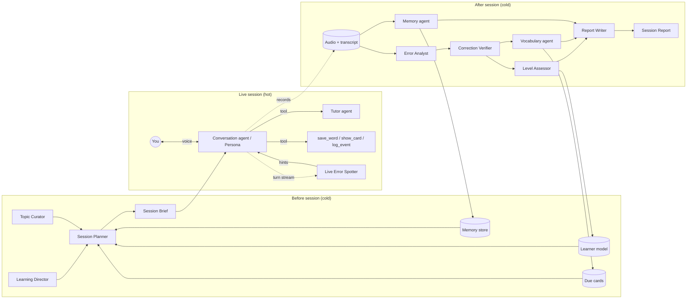
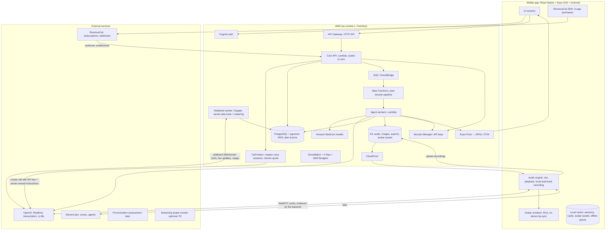
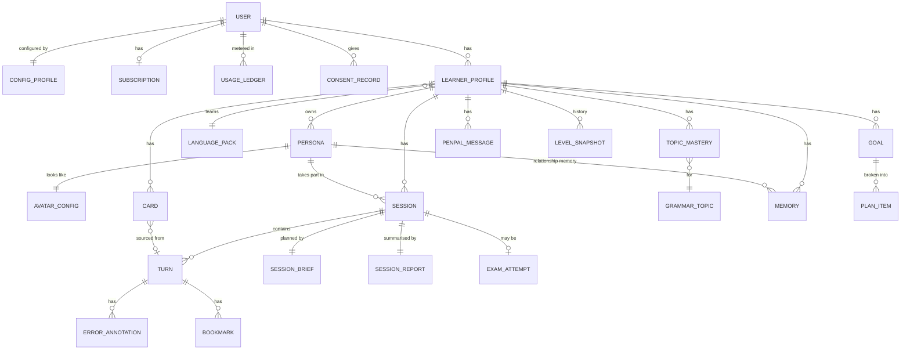
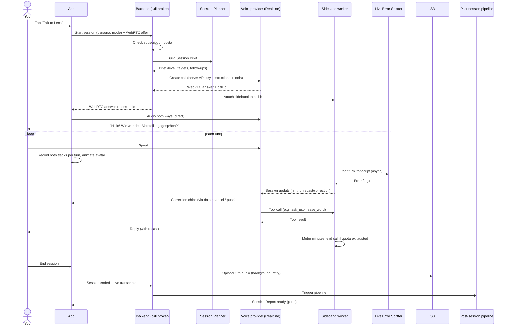

# Konvami — Product & System Design

> **App name:** **Konvami** (German *Konversation* + French *ami*). Brand guide and assets: `design/brand/konvami/` ([§20.2](#202-decision-konvami))
> **Document type:** Product specification and agentic system design. **No implementation.**
> **Status:** Draft v3 for review, 2026-10-06 (updated with two rounds of your decisions)
> **First use case:** You (the owner) learning German as efficiently as possible
> **Distribution:** Public release on the Apple App Store and Google Play
> **Platforms:** iOS and Android, one React Native + Expo codebase (TypeScript, Tailwind via NativeWind, shadcn-style components). Backend in Python with Poetry
> **Launch markets:** Switzerland, Germany, France, then the rest of the EU and Africa. UI in English, German, French and Italian
> **Resources you have:** AWS credits, an OpenAI API key, and an ElevenLabs API key later
> **Operating budget:** $150/month target, $250/month ceiling, for you plus a small tester group at first. It can be raised at any time. Minimise cost without lowering quality ([§17](#17-cost-model-and-cost-minimisation))

---

## Table of Contents

1. [Vision](#1-vision)
2. [Requirements and decisions](#2-requirements-and-decisions)
3. [Market research: existing apps, strengths and gaps](#3-market-research-existing-apps-strengths-and-gaps)
4. [Learning principles the app is built on](#4-learning-principles-the-app-is-built-on)
5. [Core concepts and vocabulary](#5-core-concepts-and-vocabulary)
6. [Feature catalogue](#6-feature-catalogue)
   - 6.1 Conversational onboarding and the Learner Configuration Profile
   - 6.2 Persona Studio
   - 6.3 Session modes
   - 6.4 The live voice session
   - 6.5 Corrections and feedback
   - 6.6 Recordings and transcript library
   - 6.7 Vocabulary and spaced repetition
   - 6.8 Grammar map and Ask-the-Tutor
   - 6.9 Adaptive level engine
   - 6.10 Conversation intelligence (the "human" part)
   - 6.11 Memory: what your buddy knows about you
   - 6.12 Goals, plans and the Learning Director
   - 6.13 Exam preparation
   - 6.14 Pronunciation lab
   - 6.15 Progress dashboard
   - 6.16 Voice-note pen-pal mode (async)
   - 6.17 Course companion and content import
   - 6.18 Notifications and proactive check-ins
   - 6.19 Settings, privacy and cost controls
   - 6.20 Animated avatars
   - 6.21 Accounts, subscriptions, store release, markets and localisation
7. [Signature features (what makes this app different)](#7-signature-features-what-makes-this-app-different)
8. [The agentic system](#8-the-agentic-system)
9. [Voice pipeline options](#9-voice-pipeline-options)
10. [System architecture on AWS](#10-system-architecture-on-aws)
11. [Data model](#11-data-model)
12. [Key flows, step by step](#12-key-flows-step-by-step)
13. [German language pack](#13-german-language-pack)
14. [Screens and UX](#14-screens-and-ux)
15. [Non-functional requirements](#15-non-functional-requirements)
16. [Quality, evaluation and safety of the agents](#16-quality-evaluation-and-safety-of-the-agents)
17. [Cost model and cost minimisation](#17-cost-model-and-cost-minimisation)
18. [Phased roadmap](#18-phased-roadmap)
19. [Risks and mitigations](#19-risks-and-mitigations)
20. [Name and logo (Konvami)](#20-name-and-logo-options)
21. [Open questions](#21-open-questions)
22. [Glossary](#22-glossary)
23. [Sources](#23-sources)

---

## 1. Vision

**A voice-first language partner that you design yourself.** It remembers you, adjusts to your level as you speak, and makes every minute of speaking count toward real progress.

You create one or more **personas** for each language. A persona is an AI character with a name, gender, age, regional accent, personality, backstory and teaching style. You then talk with it the way you'd talk with a friend, a teacher, an examiner or a colleague. Behind each persona, a team of specialist AI agents:

- listens for your mistakes
- tracks what you know and what you keep getting wrong
- plans what you should practise next
- builds flashcards from your own conversations
- quietly steers each conversation so that you practise the right things at the right difficulty

Everything is saved: every voice turn, from both you and the persona, with a synced transcript you can replay, search and learn from.

**One sentence:** *A buddy who speaks German, remembers your life, notices every mistake, and turns each chat into a personalised lesson without making it feel like one.*

### 1.1 Success criteria

| Goal | How we know it works |
|---|---|
| You speak more German, more often | Speaking minutes per week, sessions per week, streak |
| You make measurable progress | CEFR estimate goes up per skill. Error rate per grammar category goes down. Your active vocabulary grows |
| Conversations feel human | You rarely end a session early out of boredom. Topics don't repeat. The persona follows up on earlier conversations |
| Corrections are trustworthy | Fewer than 2% false corrections in spot checks (see [§16](#16-quality-evaluation-and-safety-of-the-agents)) |
| Nothing is lost | 100% of sessions have audio and a transcript that you can replay turn by turn |
| It works for more than German | A new language can be added by writing a "language pack" config, with no code changes ([§13](#13-german-language-pack)) |
| It feels personal from minute one | Onboarding is a conversation, not a form. Every personal setting lives in a profile that the user can edit at any time ([§6.1](#61-conversational-onboarding-and-the-learner-configuration-profile-p0)) |
| It is sustainable as a store app | Fixed monthly costs stay within budget. Each paying user's AI cost stays below about 60% of the net subscription revenue from that user ([§17](#17-cost-model-and-cost-minimisation)) |
| It passes store review | Approved on the App Store and Google Play on the first or second submission ([§6.21](#621-accounts-subscriptions-and-store-release-p1-required-before-public-launch)) |

---

## 2. Requirements and decisions

### 2.1 What you said

- An iOS and Android app for learning and practising **any** language. It is mainly voice interaction.
- **Configurable personas:** gender, age, accent, name, "and so on".
- **Several personas per language**, for different purposes: practice, exams, tests, courses, and so on.
- You have AWS credits and an OpenAI key, with an ElevenLabs key coming later.
- **Everything saved:** replayable voice notes plus transcriptions.
- First use case: **learning German as efficiently as possible.**
- You can ask questions about rules, how to say words, grammar, and so on.
- It should be a **buddy** for practice, with progress tracking and follow-ups.
- **Human-level conversation:** interesting topics, and automatic adjustment to your level.
- It should be a **fully agentic AI app.**

### 2.2 Decisions (your answers, 2026-10-06)

**Guiding rule: ask, don't assume.** The app never hard-codes anything personal: explanation language, level, exam, rhythm, accents or privacy. The AI asks the user, conversationally, during onboarding or later at the right moment. Every answer is saved in the **Learner Configuration Profile**, which the user can review and change at any time, from a settings screen or simply by telling a persona ([§6.1](#61-conversational-onboarding-and-the-learner-configuration-profile-p0)).

| # | Topic | Decision | Where |
|---|---|---|---|
| D1 | Explanation language | The app asks the user. Saved in the profile, editable | [§6.1](#61-conversational-onboarding-and-the-learner-configuration-profile-p0) |
| D2 | Current level and course or textbook | The app asks (self-assessment), then confirms with a voice placement test. Saved in the profile, editable, and refined automatically over time | [§6.1](#61-conversational-onboarding-and-the-learner-configuration-profile-p0), [§6.9](#69-adaptive-level-engine-p0-basic-p1-full) |
| D3 | Exam and date | The app asks. Saved in the profile, editable | [§6.1](#61-conversational-onboarding-and-the-learner-configuration-profile-p0), [§6.13](#613-exam-preparation-p1) |
| D4 | Audience | **Public release on the App Store and Google Play.** Multi-user from the start, with accounts, subscriptions, compliance and moderation | [§6.21](#621-accounts-subscriptions-and-store-release-p1-required-before-public-launch) |
| D5 | Budget | **$150/month target, $250/month hard ceiling** for operating costs. Minimise cost aggressively, but never at the expense of conversation or correction quality | [§17](#17-cost-model-and-cost-minimisation) |
| D6 | Persona visuals | **Animated avatar** for every persona | [§6.20](#620-animated-avatars-p0-basic-p1-full-p2-realistic) |
| D7 | Mobile stack | **React Native with Expo** | [§10](#10-system-architecture-on-aws) |
| D8 | Daily rhythm | The app asks. Saved in the profile, editable | [§6.1](#61-conversational-onboarding-and-the-learner-configuration-profile-p0) |
| D9 | Accent exposure | The app asks. Saved in the profile, editable | [§6.1](#61-conversational-onboarding-and-the-learner-configuration-profile-p0) |
| D10 | Privacy and audio storage | The app asks, with explicit consent screens as the stores require. Saved in the profile, editable | [§6.1](#61-conversational-onboarding-and-the-learner-configuration-profile-p0), [§6.21](#621-accounts-subscriptions-and-store-release-p1-required-before-public-launch) |
| D11 | Budget scope | At first the budget covers **you and a small tester group**. You can raise it at any time. Subscriptions fund paying users later | [§17](#17-cost-model-and-cost-minimisation) |
| D12 | Business model | **Confirmed:** free tier, 7-day trial, Plus and Pro subscriptions, minute packs | [§6.21.2](#6212-business-model) |
| D13 | Seller identity | **Individual** developer accounts on Apple and Google | [§6.21.5](#6215-publishing-as-an-individual) |
| D14 | Launch markets | **Switzerland, Germany and France first**, then the rest of the EU, then African markets | [§6.21.6](#6216-markets-and-localisation) |
| D15 | UI languages | **English, German, French and Italian** at launch (this covers all of Switzerland's main languages) | [§6.21.6](#6216-markets-and-localisation) |
| D16 | Minimum age | **16+**, confirmed | [§6.21.3](#6213-store-and-legal-compliance-checklist) |
| D17 | Avatar style | **More realistic**: adult, natural proportions, subtle shading. Not cartoonish | [§6.20](#620-animated-avatars-p0-basic-p1-full-p2-realistic) |
| D18 | Tech stack | **Backend:** Python with Poetry. **UI:** TypeScript, Tailwind CSS and shadcn/ui. In the Expo app that means NativeWind plus React Native Reusables (the shadcn/ui port). The owner web console uses shadcn/ui directly | [§10.2](#102-key-decisions) |
| D19 | Name and logo | **Konvami**, with the smiling speech-bubble-with-tongue logo (originally drawn for Linguamico). The full icon set is exported | [§20.2](#202-decision-konvami) |

### 2.3 Remaining assumptions (please correct if wrong)

| # | Assumption | Why it matters |
|---|---|---|
| A1 | Hosting is in the **EU (AWS Frankfurt, eu-central-1)**. That also suits Switzerland, which recognises the EU as providing adequate data protection, and gives reasonable latency to North and West Africa. | GDPR, Swiss data protection law (revFADP), latency |
| A2 | Live conversation needs a network connection. Review, playback and recording voice notes work offline. | Real-time voice AI runs in the cloud |
| A3 | African launch countries will be chosen later, starting with francophone markets (for example Senegal, Côte d'Ivoire, Cameroon, Morocco). Each country's data protection law and pricing gets checked before launch there. | Legal and pricing differences between countries |

---

## 3. Market research: existing apps, strengths and gaps

Research was done in October 2026 from public reviews and comparisons (see [§23](#23-sources)).

### 3.1 Comparison

| App | What it does well | What's missing or weak |
|---|---|---|
| **Speak** | Structured speaking curriculum, voice-first, role-plays, personalised review | Language coverage depends on your native language. Reviewers note **no cumulative tracking of recurring mistakes** and no structured grammar teaching |
| **Praktika** | 3D animated avatar tutors, gentle for beginners, adaptive study plans | **Rigid paths and scripted conversations.** Switching goals resets progress, and drifting off-topic gets pulled back |
| **Talkpal** | 100+ languages, many conversation modes, pronunciation assessment | Feedback quality varies by language, and conversations are fairly generic |
| **Langua** | **Remembers past sessions**, cloned-sounding natural voices, correction reports, transcripts, SRS flashcards, debates and role-play, import your own content | Fewer languages, no formal placement test, can feel heavy for quick sessions |
| **Talkio** | 400+ ready-made tutor personas, 70+ languages, 120+ dialects | Personas are pre-made rather than designed by you. Light on structured progression |
| **Pingo** | Personal learning plans, session memory, role-play, 25+ languages | Subscription-gated. Speech recognition quality varies |
| **Duolingo Max** | Video Call with characters, roleplay tied to its course | You can finish a course without being able to hold a 5-minute conversation. Not available in every course |
| **Loora** | Scenario conversations, interview and exam prep, instant feedback | English only |
| **ELSA Speak** | Excellent phoneme-level pronunciation scoring | English only, narrow scope |
| **ChatGPT Voice / Gemini Live** | Very natural, interruptible conversation | Not a tutor: no memory of your mistakes, no SRS, no progress, no curriculum, no saved audio library |

### 3.2 Features worth borrowing

- **Langua:** cross-session memory, correction reports, words saved straight from transcripts, debates, importing your own texts.
- **Praktika:** a visual character (avatar or portrait) that gives a sense of presence.
- **Talkio:** dialect and accent variety.
- **Speak:** a voice-first UI, plus short structured lessons alongside free talk.
- **ELSA:** phoneme-level pronunciation feedback.
- **Talkpal and Loora:** scenario and role-play libraries, exam modes.
- **ChatGPT Voice:** natural interruptions ("barge-in") and low latency.

### 3.3 Gaps in the market that this app targets

1. **Persona design is shallow everywhere.** Apps let you pick a tutor. None let you *design* one: age, regional accent, profession, teaching style, strictness, du/Sie, humour.
2. **Recurring mistakes are not tracked over time.** Most apps correct a mistake and then forget it. This app keeps a per-category error history and **builds the next conversations to target your weak spots**.
3. **Generic conversations.** Apps either follow scripts or chat aimlessly. This app plans each conversation around *your* interests, *your* life events and *your* learning targets.
4. **You don't own your recordings.** Few apps let you replay your own voice turn by turn, compare "then vs now", or export everything.
5. **Error detection is unreliable.** Speech recognition tends to quietly "fix" learners' grammar in the transcript, so the tutor never sees the mistake. This app is designed around **verbatim transcription** ([§9.4](#94-the-verbatim-transcription-problem-important)).
6. **No async practice.** Nobody offers a WhatsApp-style **voice-note pen pal** that you reply to whenever you like.
7. **Little German-specific exam practice.** Goethe, telc and DTZ speaking parts have specific formats (planning together, presenting, discussing) that general apps don't simulate faithfully.
8. **Your course isn't connected.** If you attend a German class, no app lets you say "practise chapter 5 of my textbook with me".

---

## 4. Learning principles the app is built on

The app is opinionated. Every feature should trace back to one of these principles.

| Principle | What it means | How the app applies it |
|---|---|---|
| **Comprehensible input (i+1)** | You learn most from language slightly above your level | The adaptive level engine keeps the persona's speech at "your level + a bit" ([§6.9](#69-adaptive-level-engine-p0-basic-p1-full)) |
| **Output hypothesis** | Speaking forces you to notice the gaps in what you know | Voice-first. The persona asks open questions, and talking time is maximised |
| **Noticing** | You must *notice* a mistake to fix it | Corrections are shown in the transcript and explained in the session report |
| **Recasts vs explicit correction** | Constant interruptions kill fluency, while no correction lets errors fossilise | A configurable correction policy: recast during the flow, explain afterwards ([§6.5](#65-corrections-and-feedback-p0)) |
| **Spaced repetition** | Reviewing just before you'd forget gives the best retention | FSRS scheduling for vocabulary and phrases ([§6.7](#67-vocabulary-and-spaced-repetition-p0-basic-p1-full)) |
| **Retrieval practice** | Recalling something beats re-reading it | Due words are *woven into conversations* so that you must produce them |
| **Targeted elicitation** | Practise exactly what you get wrong | Personas steer the topic toward structures you struggle with ([§7](#7-signature-features-what-makes-this-app-different)) |
| **Low anxiety** | Fear blocks speaking | "Flow mode" with no corrections, a patient persona, a hint button, and the option to switch to your own language |
| **Interleaving** | Mixing topics beats studying in blocks | Session plans mix one grammar focus, review items and free talk |
| **Shadowing** | Imitating native speech improves pronunciation and rhythm | A shadowing drill in the persona's voice at adjustable speed ([§6.14](#614-pronunciation-lab-p1-basic-p2-scoring)) |

---

## 5. Core concepts and vocabulary

| Concept | Definition |
|---|---|
| **Language Pack** | A configuration bundle for one target language: accents, error taxonomy, grammar map, CEFR descriptors, exam formats, pronunciation targets. German is the first ([§13](#13-german-language-pack)) |
| **Learner Model** | Everything the system believes about your skill: CEFR per skill, mastery per grammar topic, vocabulary states, error statistics |
| **Persona** | An AI character you design: identity, voice, personality, role and teaching behaviour. Personas belong to a language |
| **Session** | One conversation with a persona in a given mode. It is made of turns |
| **Turn** | One utterance by you or by the persona, with its own audio clip, transcript, timestamps and annotations |
| **Mode** | The type of session: free talk, role-play, exam simulation, Ask-the-Tutor, and so on ([§6.3](#63-session-modes-p0-unless-marked)) |
| **Session Brief** | A hidden plan generated before each session: level settings, target words, grammar focus, topics, follow-ups, correction policy |
| **Session Report** | Generated after each session: mistakes, better phrasings, new words, pronunciation notes, level estimate, next steps |
| **Memory** | Facts and episodes about you (life events, interests, preferences) plus each persona's relationship history with you |
| **Card** | A spaced-repetition item (word, phrase, sentence pattern), usually created from your own conversations |
| **Agent** | A specialised AI worker with a clear job, tools and inputs and outputs ([§8](#8-the-agentic-system)) |

---

## 6. Feature catalogue

Priority labels: **P0** = MVP must-have (roadmap phases 0–1) · **P1** = after MVP (phases 2–3) · **P2** = later or nice-to-have (phase 4). The exact phase for each feature is in [§18](#18-phased-roadmap).

### 6.1 Conversational onboarding and the Learner Configuration Profile (P0)

**Principle:** the app *asks* instead of assuming. A friendly **host persona**, with its own animated avatar, runs onboarding as a short spoken conversation. Every answer is written to the **Learner Configuration Profile**. That profile is the single source of truth that every agent reads, and the user can change it at any time.

#### 6.1.1 How onboarding works

1. **Sign-up and consent first** (required by the stores):
   - age gate
   - account (Sign in with Apple, Google or email)
   - the third-party AI disclosure and consent screen, which names the providers and what each receives ([§6.21](#621-accounts-subscriptions-and-store-release-p1-required-before-public-launch))
   - a microphone permission request that explains why it's needed
2. **Language of the conversation:** the host greets the user in the device's language ("Hi! I'll be your guide. Shall we continue in English?"). The user can switch language at once.
3. **Essential questions only** (about 3–4 minutes, spoken or tapped, never both required):
   - Which language do you want to learn? (This loads the language pack.)
   - Which language should I use when I explain things? (This sets the **explanation language**.)
   - Why are you learning it? (goals, including any exam and its date)
   - How would you rate your level today? (self-assessment, with simple can-do descriptions)
   - Are you following a course or a textbook?
4. **Voice placement test** (optional but recommended, about 8–10 minutes, can be postponed):
   - It starts at the self-assessed level and moves up or down depending on the answers (adaptive).
   - It mixes in listening checks ("What did I just say about…?"), a short description task and an opinion question.
   - Output: an estimated CEFR level per skill (speaking, listening, grammar accuracy, vocabulary range, pronunciation), plus the top 5 weak areas.
   - The user can always say "I don't know", or switch to their own language, with no penalty.
   - If the measured level differs from the self-assessment, the host explains this and **asks** which one to use as the starting point.
5. **Starter personas:** the host proposes 2–3 personas fitted to the goals (for example, a casual buddy, a patient teacher and an exam coach), each with an avatar. The user keeps, edits or deletes them.
6. **Progressive profiling:** everything else (practice rhythm, accents, interests, privacy preferences beyond the required consent, pen-pal frequency) is asked **later, at the moment it becomes relevant**, so onboarding stays short. For example:
   - after the second session: "You seem to practise in the evenings. Shall I remind you at 19:00?"
   - before the first role-play with regional colour: "Do you want to hear regional accents, or stick to Standard German for now?"
   - the first time the library fills up: "Do you want me to keep your audio in the cloud so you can replay it on any device?"
7. **A form is always available.** Every question can also be answered through a regular form. Nobody is forced to talk to set up the app.

#### 6.1.2 The Learner Configuration Profile

There is one profile per user, with a **global section** and a **section per target language**.

| Group | Field | Asked when | Notes |
|---|---|---|---|
| **Personal** | Display name, preferred form of address | Onboarding | Personas use it |
| | Native language(s), other languages spoken | Onboarding | Used for explanations and to predict typical mistakes (for example, false friends from French or English) |
| | App interface language | Onboarding (from device language, confirmed) | UI localisation |
| | Country or region, time zone | Onboarding (from the device, confirmed) | Reminders, culture-aware topics |
| | Age bracket | Sign-up age gate | Store compliance. Can influence topics, never shown to personas unless the user allows it |
| **Learning (per language)** | Target language | Onboarding | Several languages can be active |
| | **Explanation language** and how much of it to use (never / when stuck / for grammar / freely) | Onboarding | Personas can override this per persona |
| | **Self-assessed level** and **measured level** (per skill) | Onboarding plus placement, then updated automatically | Automatic changes are *suggested*, then confirmed by the user (see 6.1.3) |
| | Course or textbook, current chapter | Onboarding, then periodically ("Still on chapter 5?") | Feeds the Course agent |
| | Goals | Onboarding | Drive the Learning Director |
| | **Exam:** type, target level, date, test centre country | Onboarding, or whenever the user mentions an exam | Enables exam mode and a countdown plan |
| | Interests, and topics to avoid | Onboarding (short), then learned and confirmed | Feed the Topic Curator |
| **Rhythm** | Typical session length, preferred days and times | Asked after the first sessions, or set manually | Drives plans and reminders |
| | Reminders on/off, quiet hours, pen-pal frequency | When reminders or pen-pal are first offered | Notifications respect these |
| | Hands-free use (commute, walking, cooking) | When hands-free mode is first offered | Sets audio and UI defaults |
| **Accents** | Preferred accents or regions, where the user lives or plans to live, dialect ladder on/off | Before the first regional content, or when the user mentions moving | Affects persona voice suggestions and listening practice |
| **Corrections (defaults)** | Correction timing and strictness, max interruptions | First session wrap-up ("Was that too many corrections?") | Personas can override them |
| **Privacy** | Audio storage: cloud (replay anywhere) · on this device only · transcripts only | First time a recording is saved | Honest notice: live audio is still processed by the AI providers during sessions |
| | Retention period (forever / 1 year / 90 days) | Same moment | Older items are deleted automatically |
| | Memory on/off, and memories the buddy may keep | First time a memory is created | Linked to "What my buddy knows about me" |
| | Third-party AI consent (per provider), analytics consent | Sign-up, revocable at any time | Required by Apple guideline 5.1.2(i) and GDPR |
| **Display** | Avatar or voice-orb mode, captions default, reduce motion | First session | Accessibility and battery |
| **Plan** | Subscription tier, minutes used and remaining | Shown, not asked | [§6.21](#621-accounts-subscriptions-and-store-release-p1-required-before-public-launch) |

#### 6.1.3 Changing the profile

- **Settings screen "My profile":** every field is grouped as above, editable, and shows **where its value came from** ("You told me", "Measured in placement", "Learned from your sessions") and when it was last changed.
- **By voice, anywhere:** "Explain things in French from now on", "My exam moved to June", "I'm on chapter 7 now". The persona confirms the change ("Okay, I'll explain in French from now on, right?") and calls the `update_profile` tool. The change is logged and can be undone.
- **AI-suggested updates:** when the system infers something (a higher level, a new interest, a changed routine), it **proposes** the change and never applies it silently. Measured CEFR estimates update automatically in the learner model. Whether the *difficulty setting* follows them is the user's choice.
- **Review prompts:** every 2–3 months, or after big changes (exam passed, level-up), the host offers a 1-minute "Is this still right?" check-in.

### 6.2 Persona Studio (P0)

The heart of personalisation. A persona has five groups of settings.

**A. Identity**

| Field | Examples |
|---|---|
| Name | Lena, Jonas, Frau Schmidt, Herr Bauer |
| Gender | Female, male, non-binary |
| Age | 18–80 (this affects vocabulary, slang and references) |
| Origin and accent | Standard German (Hochdeutsch), Berlin, Bavarian, Swabian, Saxon, Hamburg (northern), Austrian (Vienna), Swiss German-influenced Standard German, Cologne |
| Occupation and background | Student in Leipzig, nurse in Munich, retired teacher in Vienna, software engineer in Berlin |
| Animated avatar | Each persona has its own animated character that matches its gender, age and style: face, skin tone, hair, glasses, clothing, accessories. Generated from the persona description and editable ([§6.20](#620-animated-avatars-p0-basic-p1-full-p2-realistic)) |
| Backstory | Free text, which the persona will use consistently ("Lena grew up in Dresden, plays volleyball, has a cat named Krümel") |

**B. Voice**

| Field | Notes |
|---|---|
| Voice | Chosen from the voice provider's catalogue and filtered by gender, age and accent. Preview before saving |
| Speaking speed | Auto (follows your level) or a fixed value from 0.7× to 1.2× |
| Accent strength | Neutral, light regional, strong regional (P1, depends on the voice provider) |
| Voice provider | OpenAI (MVP) or ElevenLabs (later, for much richer voice choice and accents) — see [§9](#9-voice-pipeline-options) |

**C. Personality**

- Traits as sliders: warm ↔ reserved, playful ↔ serious, talkative ↔ concise, curious ↔ laid-back, humorous ↔ dry.
- Interests and opinions, so that the persona has views and can debate.
- Register: **du** (informal) or **Sie** (formal), or "match the situation".
- Conversation style: asks lots of questions, tells stories, or debates.

**D. Role (what the persona is for)**

| Role | Behaviour |
|---|---|
| **Buddy** | Casual friend. Chats about life, recasts mistakes gently, low pressure |
| **Teacher** | Explains, gives mini-lessons, checks understanding, more explicit corrections |
| **Exam Coach / Examiner** | Runs timed exam simulations in official formats and scores you with a rubric. Formal and neutral during the test, then a coach afterwards |
| **Role-play partner** | Plays characters in scenarios: baker, doctor, landlord, immigration office clerk, interviewer |
| **Course companion** | Follows your textbook or class syllabus |
| **Custom** | Any combination you write yourself |

**E. Teaching behaviour**

| Setting | Options |
|---|---|
| Correction timing | During the flow (recast) · Immediate explicit · End of session only · Off (flow mode) |
| Correction strictness | Only errors that block meaning · Important errors · Everything |
| Max interruptions | For example, at most 1 explicit correction per 2 minutes |
| Use of your own language | Never · Only when you're stuck · For grammar explanations · Freely |
| Difficulty | Auto (recommended) · Fixed CEFR level |
| Target-structure focus | Auto (from your weak spots) · Manual ("Practise Dativ and Perfekt with me") |

**Other Persona Studio features**

- **Create from description (P0):** type or say "A 30-year-old woman from Hamburg, friendly, works in marketing, loves sailing, helps me prepare for job interviews". The Persona Builder agent fills in every field, including the avatar look and a matching voice, and you review them.
- **Templates (P0):** Casual Buddy, Patient Teacher, Goethe B1 Examiner, Job Interviewer, Doctor (role-play), Landlord (role-play), Debate Partner.
- **Duplicate, edit, archive (P0).**
- **Per-persona memory (P1):** each persona remembers its own history with you ("Last week you told me about your trip to Hamburg"). All personas share one learner model, so your skill level is the same everywhere.
- **Persona ensembles (P2):** two personas in one conversation (for example, a couple asking you for restaurant tips). This is good for listening to natural, native-speed dialogue and joining in.

**Guardrails:** personas cannot imitate real, identifiable people's voices. Voice cloning is allowed only for your own voice or a voice whose owner gave consent (ElevenLabs requires verification for this).

### 6.3 Session modes (P0 unless marked)

| Mode | Description |
|---|---|
| **Free conversation** | Open chat. The persona brings interesting topics guided by the Session Brief |
| **Guided lesson** | 10–15 minutes on one grammar or vocabulary goal: short explanation → examples → you produce → feedback → free use in conversation |
| **Role-play scenario** | Real-life situations: bakery, doctor, pharmacy, train station, Bürgeramt (registering your address), Ausländerbehörde (immigration office), viewing a flat, job interview, phone call, complaint, small talk at work. Each has goals ("find out the price and the opening hours") and is marked complete when you reach them |
| **Ask-the-Tutor** | You ask anything: "When do I use *wo* vs *wohin*?", "How do I say *I'm looking forward to it*?", "Why is it *dem* here?" You get a clear spoken answer with examples, plus an on-screen card |
| **Exam simulation** (P1) | Official speaking-test formats, timed, then scored ([§6.13](#613-exam-preparation-p1)) |
| **Pronunciation lab** (P1) | Minimal pairs, shadowing, problem sounds ([§6.14](#614-pronunciation-lab-p1-basic-p2-scoring)) |
| **Review conversation** (P1) | A short chat built around your due flashcards, so you practise retrieval in context |
| **Debate** (P1) | The persona takes a side and you argue the other. Great at B1 and above |
| **Story mode** (P1) | You and the persona build a story together, or the persona tells a story at your level with comprehension questions |
| **News and topic discussion** (P2) | The persona brings a current news item at your level (using a web search tool) |
| **Dictation and listening** (P2) | The persona speaks and you repeat or summarise it |
| **Real-life rehearsal** (P1) | "Tomorrow I have an appointment at the Ausländerbehörde." The app rehearses the scenario with you, then debriefs you afterwards ([§7](#7-signature-features-what-makes-this-app-different)) |
| **Hands-free / walk mode** (P1) | Screen-off, headphone-friendly sessions while walking, commuting or cooking |

### 6.4 The live voice session (P0)

What the screen and the conversation offer during a session:

- **Animated avatar:** the persona's character fills the top of the screen. It lip-syncs while speaking, nods and keeps eye contact while you speak, looks thoughtful while it prepares a reply, and reacts with expressions (smiles, surprise, encouragement). You can switch to a minimal voice orb to save battery or for hands-free use ([§6.20](#620-animated-avatars-p0-basic-p1-full-p2-realistic)).
- **Natural turn-taking:** you just talk. The app detects when you've finished (voice activity detection), and you can **interrupt** the persona (barge-in).
- **Push-to-talk option:** for noisy places, or if you need thinking time without the AI jumping in.
- **Patience setting:** how long the persona waits during your pauses. Learners pause a lot, so the default is generous.
- **Live captions:** toggle the persona's text, your text, both or none. Captions can be blurred until tapped, which is a good listening challenge.
- **Tap any word** in the captions to see its translation, gender and plural, hear it, or **save it to your cards**.
- **Help buttons:**
  - 🆘 **I'm stuck:** the persona offers a hint or a starter sentence.
  - 🐢 **Slower:** the persona repeats more slowly.
  - 🔁 **Repeat.**
  - 🌍 **Translate the last line** into your explanation language.
  - ❓ **Explain:** opens Ask-the-Tutor about the last thing said, and then returns to the conversation.
- **Code-switching:** you can say, in English or your own language, "How do I say 'I missed the bus'?" The persona gives the German, asks you to repeat it, and continues.
- **Correction chips:** when the persona recasts a mistake, a small chip appears on your turn (for example, *"mit der Bus" → "mit dem Bus"*). Tap it for an explanation, or ignore it.
- **Session timer and goal progress:** for example, "3 of 5 target words used" and "role-play goal: 2/3".
- **Pause and resume:** sessions survive app backgrounding and short network drops.
- **End session:** this triggers the post-session pipeline, and the report is ready within seconds.

### 6.5 Corrections and feedback (P0)

**During the session**, the correction policy from the persona settings applies. The default policy for the Buddy role is:

1. Errors that block meaning → the persona asks for clarification naturally ("Meinst du gestern oder morgen?").
2. Errors in today's **focus structures** → an explicit but short correction ("Kleine Sache: *mit dem Bus*, weil *mit* immer Dativ ist. Weiter!").
3. Other errors → an implicit **recast**: the persona repeats your idea correctly in its reply without stopping. The error is logged silently.
4. A rate limit on explicit corrections, so the conversation keeps flowing.

**After the session, the Session Report contains:**

| Section | Content |
|---|---|
| Summary | What you talked about and how long you spoke (talk-time ratio: you vs persona) |
| Mistakes | Each mistake with your original sentence, the corrected version, a short explanation, the grammar category, and a link to the audio of that turn |
| Better ways to say it | Correct but unnatural sentences → how a native speaker would say them ("correct ✔ / more natural ✨") |
| New vocabulary | Words the persona used that are new for you, plus words you asked about. One tap adds them to cards (or they're added automatically) |
| Pronunciation notes | Sounds or words to work on (P1 with scoring) |
| Fluency metrics | Words per minute, average pause length, longest German-only stretch, share of your own language used, filler words |
| Level estimate | Session CEFR estimate per skill and the trend |
| Wins | "You used Perfekt with *sein* correctly 4 times! 🎉" |
| Next steps | 1–3 concrete targets that feed the next Session Brief |

- **"Say it better" retry (P1):** on any corrected turn, tap 🎙️ to re-record the sentence correctly, then hear your before and after side by side.
- **Explain my mistake (P0):** tap any correction for a deeper explanation from the Tutor agent, with more examples and a mini exercise.

### 6.6 Recordings and transcript library (P0)

"Everything should be saved" is a core promise.

- **Every session is stored:** both voices, segmented per turn, with a transcript synced word by word (karaoke-style highlighting during playback).
- **Playback controls:** play the whole session or a single turn, speed 0.5×–2×, skip between your turns only or the persona's turns only, and loop a turn.
- **Inline annotations:** mistakes, corrections, new words and bookmarks are shown on the transcript.
- **Search across everything:** "Find every time I said *weil*", "every session where we talked about football", "all my Dativ mistakes". This is full-text plus semantic search.
- **Bookmarks and notes** on any turn.
- **Filters:** by persona, mode, date, topic or error category.
- **Then vs Now (P1):** compare a recording from your first week with today on a similar topic ([§7](#7-signature-features-what-makes-this-app-different)).
- **Export:** audio (M4A/MP3) and transcript (TXT/PDF/Markdown/JSON), per session or everything. You own your data.
- **Offline playback:** recent sessions are cached on the device, and you can pin sessions for offline use.
- **Storage:** audio is stored compressed (Opus or AAC, about 10–15 MB per hour). Where the audio is kept (cloud, device only, or transcripts only) and for how long follow each user's privacy choices in the Learner Configuration Profile ([§6.1.2](#612-the-learner-configuration-profile)). Older audio is moved to cheaper storage automatically.

### 6.7 Vocabulary and spaced repetition (P0 basic, P1 full)

- **Automatic card creation:** the Vocabulary agent proposes cards from:
  - words you asked about
  - words the persona used that are new to you
  - your corrected mistakes (as sentence patterns)
  - words you tapped and saved
- **Rich German cards:**
  - Nouns: article plus colour coding (der = blue, die = red, das = green, an optional convention), plural, and an example.
  - Verbs: infinitive, the 3rd person present (er/sie/es), Präteritum, Partizip II with haben/sein, whether it's separable, and the case it takes.
  - Adjectives: comparative and superlative.
  - **The example sentence comes from your own conversation** whenever possible. That context helps memory.
  - **Audio in your persona's voice.**
- **Scheduling:** the FSRS algorithm (a modern spaced-repetition scheduler, more efficient than the classic SM-2).
- **Review formats:**
  - Classic flip cards (tap).
  - **Voice review:** the app says the English word or a cloze sentence and you answer in German out loud.
  - **Review conversation:** due words are woven into a chat, and the persona creates situations where you need them (P1, signature feature).
- **Active vs passive vocabulary:** words you've *heard* vs words you've *produced* correctly in conversation. Progress counts both.
- **Phrasebook:** a personal list of phrases you need in your life ("Ich hätte gern einen Termin", "Könnten Sie das bitte wiederholen?").
- **Anki export (P2).**

### 6.8 Grammar map and Ask-the-Tutor (P0 Ask-the-Tutor, P1 map)

- **Grammar map:** every German grammar topic from A1 to C2 (from the language pack). Each topic shows a mastery level (not started → introduced → practising → mostly correct → mastered), **based on evidence from your conversations**, not just on quizzes.
- **Topic page:** a short explanation (in your explanation language plus German), examples, common learner mistakes, **your own mistakes on this topic with audio links**, and buttons for "Practise this in conversation" and "Quick quiz".
- **Ask-the-Tutor:** available as a mode, as a mid-conversation button and as text chat. Answers come from the Tutor agent, which is **grounded in a curated grammar reference** (retrieval-augmented) to avoid invented rules ([§16](#16-quality-evaluation-and-safety-of-the-agents)).
- **On-demand mini-lessons:** "Teach me Konjunktiv II in 10 minutes."
- **Generated exercises:** fill in the blank, transformations ("put this into Perfekt"), sentence building and translation, all spoken or tapped.

### 6.9 Adaptive level engine (P0 basic, P1 full)

The app continuously estimates your level and adjusts how the persona speaks.

**Signals it uses**

- grammar accuracy per category
- vocabulary range: word frequency bands you use and understand
- sentence complexity: subordinate clauses, tenses, connectors
- fluency: speech rate, pauses
- comprehension: clarification requests, "Wie bitte?", wrong answers to the persona's questions
- how often you use the help buttons and how often you switch to your own language

**What it adjusts**

| Lever | Lower level (A1–A2) | Higher level (B2–C1) |
|---|---|---|
| Speech rate | Slow, clear pauses | Natural native speed |
| Sentence length | Short main clauses | Complex, nested clauses |
| Tenses | Present, Perfekt | All, including Konjunktiv and Passiv |
| Vocabulary | Top 1,000–2,000 words | Idioms, colloquialisms, regional words |
| Topics | Self, family, daily routine, food | Abstract topics, opinions, society, hypotheticals |
| Use of your own language | Allowed for help | German only |
| Questions | Closed and either/or questions | Open "why / what if" questions |

**Rules**

- **i+1:** aim for about 90–95% of the persona's words being known to you, with a few new items per session.
- **Frustration detection:** a cluster of long pauses, repeated "Wie bitte?", or switching to your own language → the persona simplifies right away and is encouraging.
- **Boredom detection:** very short, fast, error-free answers → it increases the challenge.
- **Level-up moments:** when the estimate crosses a threshold, the app celebrates and proposes harder content. It never jumps silently.
- **Manual override:** "Speak to me like a native, I want a challenge" or "Make it easier today".

### 6.10 Conversation intelligence (the "human" part) (P0)

What separates a good buddy from a chatbot:

1. **It has a life.** The persona has a consistent backstory, opinions and things happening in its life ("Ich war gestern beim Volleyball, wir haben endlich gewonnen!"), and it shares them like a person does.
2. **It remembers yours.** It follows up on things you mentioned ("Wie war dein Vorstellungsgespräch am Freitag?") — see [§6.11](#611-memory-what-your-buddy-knows-about-you-p0-basic-p1-full).
3. **It's curious.** It asks open questions and follow-ups, and digs into your answers instead of jumping to new topics.
4. **It brings interesting topics.** The Topic Curator agent picks them from:
   - your interests
   - current events (P2)
   - German culture (Feierabend, Kaffee und Kuchen, Pfand, Sunday quiet hours)
   - controversies suited to your level ("Should cities ban cars?")
   - "would you rather" games
5. **No repetition.** It keeps a topic history and avoids repeating topics, questions and stories within a window.
6. **Natural speech.** At the right level it uses fillers and discourse particles (*also, na ja, halt, eben, doch, mal*), reactions (*Echt? Krass! Ach so!*) and humour.
7. **Cultural notes.** It occasionally adds a one-line cultural insight ("In Germany, you'd usually say *Mahlzeit* at lunchtime at work").
8. **Balanced talk time.** The target is that you talk 60–70% of the time. If the persona talks too much, the system tells it to ask more and say less.
9. **It steers invisibly.** It brings in target structures naturally (see "Targeted elicitation" in [§7](#7-signature-features-what-makes-this-app-different)).

### 6.11 Memory: what your buddy knows about you (P0 basic, P1 full)

Memory comes in three layers:

| Layer | Contents | Example |
|---|---|---|
| **Learner model** (structured) | Levels, mastery, error stats, vocabulary states | "Dativ after prepositions: 58% correct, improving" |
| **Personal memory** (shared across personas) | Facts and events from your life, your preferences and goals | "Has a job interview on 2026-10-10", "Supports Bayern München", "Doesn't like talking about politics" |
| **Persona relationship memory** (per persona) | Shared stories, running jokes, what this persona has told you | "Lena told you about her cat Krümel. You promised to send her a photo of Hamburg" |

- **Writing memories:** the Memory agent extracts candidate memories after each session, removes duplicates, and adds dates. Time-bound items ("interview on Friday") are given a follow-up date.
- **Reading memories:** before each session, relevant memories are pulled in by recency, importance and similarity to the planned topics, and they go into the Session Brief.
- **Your control:** the screen **"What my buddy knows about me"** lets you view, edit or delete any memory, or mark a topic as off-limits. During a conversation you can also say "Forget that".

### 6.12 Goals, plans and the Learning Director (P1)

- **Set goals:** for example, "Reach B1 speaking by March 2027", "Pass Goethe B1 on 2027-04-15", "Have a 20-minute conversation with no help".
- The **Learning Director agent** (a planner) turns goals into a **weekly plan**: minutes per mode, grammar topics in order, exam simulations, review targets.
- **Daily "Today" card:** "15 minutes: 5 minutes of review conversation with Lena + a 10-minute role-play at the doctor's (focus: Dativ, body parts)."
- **Weekly check-in (voice):** your chosen persona gives you a 2-minute spoken weekly review ("This week you spoke for 94 minutes, three more than last week…") and asks whether to adjust the plan.
- **Adaptive re-planning:** if you skip days or progress faster or slower than expected, the plan adjusts automatically and tells you why.

### 6.13 Exam preparation (P1)

- **Supported formats** (stored as editable config in the language pack; always check them against the official exam handbooks):

| Exam | Speaking parts (simplified) |
|---|---|
| Goethe-Zertifikat A1 | Introduce yourself · ask for and give information · make requests and respond |
| Goethe-Zertifikat A2 | Questions about yourself · talk about your life · plan something together |
| Goethe-Zertifikat B1 | Plan something together · present a topic · respond to feedback and questions |
| Goethe-Zertifikat B2 | Give a talk plus questions · discussion |
| telc Deutsch B1 | Make contact · conversation about a topic · plan something together |
| DTZ (Deutsch-Test für Zuwanderer, A2–B1) | Introduce yourself · talk about experiences (picture) · plan something together |
| TestDaF / ÖSD | Task sets as defined by the exam bodies |

- **Examiner persona:** neutral, formal, follows the official timing, and does not help during the test. In two-candidate formats (Goethe B1 "plan together"), the **examiner and a second candidate persona** take part.
- **Prompt cards:** realistic task cards shown on screen, including pictures for the picture-description tasks.
- **Preparation timer:** prep time as in the real exam, with an optional note-taking area.
- **Scoring:** the Exam Scorer agent applies **rubric criteria similar to the official ones** (task completion, coherence, vocabulary, grammar, pronunciation) and gives an estimated score per part with justification. It is clearly labelled as an estimate, not an official score.
- **Model answers:** an example of a strong answer at the target level, in audio and text.
- **Exam readiness tracker:** your score trend across simulations, your weakest part, and the predicted readiness date.
- **Phrase banks per task:** useful phrases for planning together, presenting and agreeing or disagreeing, turned into cards.

### 6.14 Pronunciation lab (P1 basic, P2 scoring)

- **German problem sounds:** ü / u / i, ö / o / e, the *ich-Laut* [ç] vs the *ach-Laut* [x], the German *r*, final devoicing (Auslautverhärtung: *Hund* → [hʊnt]), long vs short vowels (*Staat / Stadt*, *Höhle / Hölle*), the glottal stop, *-ig* endings, word and sentence stress, sp-/st- → [ʃp]/[ʃt].
- **Minimal pair drills:** you hear two words and pick one, then say both and get feedback.
- **Shadowing:** the persona speaks a sentence and you repeat it right after or along with it. Speed is adjustable and a waveform comparison is shown.
- **Your problem words:** automatically collected from your sessions (words that were misrecognised or scored low).
- **Pronunciation scoring (P2):** phoneme-level scores need a dedicated pronunciation assessment service. Neither OpenAI nor AWS provides one directly (see [§9.5](#95-pronunciation-assessment)).

### 6.15 Progress dashboard (P0 basic, P1 full)

- **Level card:** estimated CEFR per skill (speaking, listening, grammar, vocabulary, pronunciation) with trend arrows.
- **Activity:** speaking minutes per day and week, streak, sessions per mode, talk-time ratio.
- **Accuracy trends:** error rate per grammar category over time. This is a "mistake heatmap" showing what's improving and what's stuck.
- **Vocabulary:** total words, active vs passive, cards due, retention rate.
- **Fluency trends:** words per minute, average pause, longest German-only stretch.
- **Milestones:** "First 10-minute conversation with no help", "100 words used actively", "First Konjunktiv II", "Survived the Ausländerbehörde role-play".
- **Then vs Now:** audio comparisons ([§7](#7-signature-features-what-makes-this-app-different)).
- **Weekly report:** shown in the app plus the optional voice version from your persona.
- **Gamification stays light:** streaks and milestones are fine. There are no gems, leagues or anything that rewards tapping over speaking.

### 6.16 Voice-note pen-pal mode (async) (P1, signature feature)

Like having a German friend on WhatsApp:

- A persona **sends you voice notes** on its own: about its day, a question about yours, a follow-up on something you said, or a small challenge ("Erzähl mir von deinem Lieblingsessen!").
- You **reply with a voice note** whenever it suits you. There's no real-time pressure, so you have time to think, which is perfect for anxious speakers or busy days.
- Each of your voice notes is transcribed and analysed in the same way as live sessions. Corrections arrive as a reply ("Super Nachricht! Kleine Korrektur: …").
- The thread looks like a chat, with every note replayable and transcribed.
- Frequency and quiet hours are configurable.

### 6.17 Course companion and content import (P1)

- **Course sync:** tell the app your textbook and chapter (for example, *Menschen A2, Lektion 5*), or upload a photo or PDF of the page. The Course agent extracts the vocabulary and grammar, and personas practise exactly that material.
- **Import anything:** paste a text or URL, take a photo of a menu, letter or article, or upload an audio file. Then:
  - the persona discusses it with you at your level
  - the app explains hard sentences
  - it creates cards from the new words
- **Official letters helper:** Germany runs on paperwork. Photograph a letter and the app helps you understand it, then rehearses the phone call or the reply.

### 6.18 Notifications and proactive check-ins (P1)

- Practice reminders at your chosen times, worded by your persona ("Lena: Hast du 10 Minuten? Ich muss dir was erzählen!").
- A follow-up nudge for real-life events ("Your appointment was today. Want to tell me how it went, in German?").
- A cards-due reminder.
- A "word of the day" 30-second voice clip (optional).
- All of these respect quiet hours, have a frequency limit, and can be switched off completely.

### 6.19 Settings, privacy and cost controls (P0)

- **My profile:** the full Learner Configuration Profile ([§6.1.2](#612-the-learner-configuration-profile)): languages, level, goals, exam, rhythm, accents, correction defaults. Every field shows where its value came from.
- **Audio:** input device, noise suppression, echo cancellation, push-to-talk vs automatic, patience (pause tolerance).
- **Privacy** (choices are stored in the profile):
  - full data export
  - delete a session, memory or account (a real deletion, including stored audio). In-app account deletion is required by Apple
  - audio storage mode (cloud, device only, transcripts only) and retention period
  - per-provider AI consent, revocable at any time
- **Subscription and usage (users):** current plan, voice minutes used and remaining, upgrade, restore purchases.
- **Owner admin console (you only, a web dashboard, not in the store app):**
  - total spend per day and month, per provider and per feature
  - per-user cost outliers
  - budget alerts at 50%, 80% and 100% of the $150 target and the $250 ceiling
  - global kill switches, for example turning off the free tier's live voice if the budget is threatened
- **Engine and model tiers** are chosen server-side by the routing policy ([§17.3](#173-cost-minimisation-strategy-without-lowering-quality)). Users don't have to understand models. Pro users can choose premium voices.
- **Accessibility:** captions, adjustable text size, haptic turn cues, screen reader labels.

### 6.20 Animated avatars (P0 basic, P1 full, P2 realistic)

Every persona has a face. The avatar gives presence (Praktika's main strength) and makes the persona feel like a person rather than a speaker icon.

#### 6.20.1 Avatar behaviour

| State | What the avatar does | Driven by |
|---|---|---|
| **Idle** | Breathing, blinking, small natural movements | Timer and randomness |
| **Listening** | Eye contact, small nods, a slight lean in while you speak | On-device voice activity detection on your microphone |
| **Thinking** | Looks aside or tilts its head while the reply is prepared, which hides latency in a natural way | The gap between your turn ending and the reply starting |
| **Speaking** | Lip-sync matched to the voice | The persona's audio (amplitude in the MVP, visemes in P1) |
| **Expressions** | Happy, surprised, empathetic, encouraging, confused, amused | Emotion tags emitted by the Conversation agent (`set_expression` tool) or inferred from the reply text |
| **Teaching gestures** | A gentle "hmm" for a correction, a thumbs-up for a correct use of a focus structure, a celebration on milestones | Events from the Live Error Spotter and the goal tracker |

#### 6.20.2 Options compared

| Option | Look | Marginal cost | Pros | Cons |
|---|---|---|---|---|
| **A. Stylised 2D, rendered on the device (Rive)** | Illustrated characters, similar to Duolingo's characters | **$0 per minute** | Runs at 60 fps on most phones. Tiny files. No extra latency or bandwidth. Rive has a React Native runtime and state machines built for lip-sync. Works offline for idle states | Needs a character design system (artist work up front). Not photorealistic |
| **B. Stylised 3D, rendered on the device** (VRM models with three.js / react-three-fiber via expo-gl) | 3D, game-like characters | $0 per minute | More depth and head movement, many customisation options | Heavier on low-end Android, larger downloads, more engineering |
| **C. Photorealistic streaming video avatar** (cloud providers such as Simli, LiveAvatar, Tavus, Anam) | A realistic human on video | About $0.01–$0.40 per minute depending on the vendor (reported September 2026, check with each vendor) | Very lifelike | Mobile bandwidth and battery use, extra latency, vendor lock-in, privacy disclosures, and the "uncanny valley" |

**Recommendation:**

**Decision: a more realistic style (D17).** The recommendation is updated accordingly:

- **MVP (P0):** **Option A in a semi-realistic art direction.** Adult characters with natural proportions, realistic skin tones and hair, soft painterly shading and subtle facial movement. Think "high-quality illustrated portrait that breathes", not a cartoon mascot. The character system is modular (face shapes, skin tones, hairstyles, eyes, glasses, beards, clothing, age features such as wrinkles and grey hair), so every persona looks unique. Mouth movement follows audio amplitude, plus idle, listening and thinking states. It still costs nothing to run.
- **P1:** viseme-accurate lip-sync (about 10 mouth shapes, which matters more as faces look more realistic), expressions, eye saccades, teaching gestures, and an avatar editor in Persona Studio.
- **Moved earlier, to Phase 3 instead of P2:** a **Realistic video mode** spike. Some streaming-avatar vendors now report prices around $0.01/minute at scale. If a vendor passes the tests for latency, German lip-sync quality, mobile data use and data protection, photorealistic avatars could be offered to Plus and Pro users without hurting the budget. Until then it remains a Pro-only option priced to cover its cost.
- **Art sourcing:** realistic illustrated characters need a skilled character artist. A commissioned Rive character system is the higher-quality route. A licensed base pack customised by a freelancer is the cheaper route. Both are one-time costs ([§17.2](#172-fixed-and-shared-monthly-costs-your-budget)).

#### 6.20.3 Technical notes

- **Lip-sync needs access to the persona's audio on the device.** With WebRTC, the audio is played by the WebRTC stack, which React Native doesn't expose easily. Options:
  1. A small native module that taps the output audio level.
  2. Receiving audio over WebSocket and playing it through the app's own audio engine. This gives full access to the samples, but echo cancellation must then be handled with the platform's voice-processing audio mode.
  3. With ElevenLabs TTS, character-level timestamps can be mapped to visemes.

  This is a **Phase 0 spike** item ([§18](#18-phased-roadmap)).
- **Performance budget:** at least 30 fps on low-end Android, and 60 fps on mid-range and better devices. The app falls back automatically to the voice orb when the battery is low, the device is overheating or "reduce motion" is on.
- **Assets:** avatar parts are downloaded once and cached. A persona's look is stored as a small JSON config of part IDs and colours.
- **Persona Builder:** maps a text description to an avatar config ("60-year-old man, grey beard, glasses, Viennese coffee-house style" → part IDs). The user can then fine-tune it.
- **No real people:** avatars are illustrated characters. Users can't upload photos of real people to create avatars, which avoids likeness and consent problems.

### 6.21 Accounts, subscriptions and store release (P1, required before public launch)

#### 6.21.1 Accounts

- Sign in with Apple (mandatory on iOS when other social logins are offered), Google, and email with a magic link.
  - **Sign-up as built (2026-10-09):** email + password, verified with a 6-digit code, as drawn on the approved screens 2.3 and 2.4. The magic link remains an option for signing in (screen 3.4). See `2026-10-09-create-account-design.md`.
- In-app **account deletion**, which deletes all data including audio. Apple requires this.
- Multiple devices, with data synced through the backend.

#### 6.21.2 Business model

Prices are illustrative and will be validated in beta.

| Tier | Price (illustrative) | Includes |
|---|---|---|
| **Free** | €0 | About 15 voice minutes per week on the efficient voice tier · unlimited flashcard review, library playback and text Ask-the-Tutor (low cost) · 2 personas |
| **Plus** | About €14.99/month or €99/year | About 250 voice minutes/month · unlimited personas · full reports, memory, plans, pen-pal |
| **Pro** | About €29.99/month or €199/year | About 600 voice minutes/month · exam simulations with scoring · premium voices (ElevenLabs) · Realistic avatar mode (when available) |
| **Minute packs** | One-off purchases | Extra minutes after the quota is used up |

- **Fair-use quotas are enforced on the server** ([§10](#10-system-architecture-on-aws)), because a client-side limit can be bypassed.
- **Free trial:** 7 days of Plus.
- Purchases go through **Apple In-App Purchase and Google Play Billing**, which are mandatory for digital subscriptions in most regions, managed with **RevenueCat**. RevenueCat handles receipts, entitlements, trials and cross-platform subscription status, and has an Expo-compatible SDK.
- **Store fees:** 15% under the Apple App Store Small Business Program and Google Play's 15% rate for the first $1M, otherwise up to 30%. These fees are included in the unit economics in [§17](#17-cost-model-and-cost-minimisation).

#### 6.21.3 Store and legal compliance checklist

| Requirement | What the app does |
|---|---|
| **Apple 5.1.2(i): third-party AI data sharing** | Before any data is sent, a consent screen names each AI provider (OpenAI, ElevenLabs, AWS Bedrock, and the avatar vendor if used), says what data each receives (voice, transcripts, profile context) and why, and asks for explicit permission. Consent can be revoked in Settings |
| **Privacy labels and Data safety form** | Accurate declarations: audio, transcripts, usage data, purchase history. No tracking across apps without App Tracking Transparency consent (none planned) |
| **Google Play AI-generated content policy** | In-app reporting of offensive or harmful AI output (the "flag" button on every turn), plus prompt-level safety rules |
| **Account deletion** | In the app, plus a web form for users who have uninstalled |
| **Age rating and gate** | Minimum age 16 (decision D16). The persona content policy keeps the app suitable for a 12+/Teen rating |
| **Microphone permission** | A clear purpose string. The app degrades gracefully to text if permission is refused |
| **Subscriptions** | Clear pricing, trial terms, a restore-purchases button, links to the terms and privacy policy |
| **GDPR** | Data processing agreements with all providers. EU hosting by default. Data export and deletion. Lawful basis and consent records. Provider data-retention and no-training settings (check each provider's API data policy and its EU data-residency options) |
| **EU AI Act transparency** | It is always clear that personas are AI. The avatar and voice never claim to be human (Article 50 transparency obligations, applicable from August 2026, so check the current guidance) |
| **Background audio** | Declared only for hands-free mode, and justified in the review notes |
| **Review notes** | A demo account with minutes, and an explanation of the AI features and consent flow for the reviewers |

#### 6.21.4 Also needed for a public app

- **Localised UI:** English, German, French and Italian at launch ([§6.21.6](#6216-markets-and-localisation)). Store listings in the same four languages.
- **Crash and performance monitoring:** Sentry, with an Expo integration.
- **Privacy-friendly product analytics:** for example PostHog hosted in the EU, used only with consent.
- **Support:** an in-app feedback form, an FAQ, and a support email.
- **Abuse prevention:**
  - per-user rate limits
  - server-owned persona instructions, so users can't inject their own system prompt
  - moderation of user-written persona backstories and descriptions
  - monitoring for jailbreak attempts
- **Store presence:** screenshots and a preview video (avatars help here), a description in multiple languages, and ratings prompts after positive moments (a level-up or a milestone), never mid-session.

#### 6.21.5 Publishing as an individual

| Topic | What it means for you |
|---|---|
| **Seller name** | Apple and Google show **your personal legal name** as the seller or developer. A company account (which needs a D-U-N-S number) can come later, and apps can be transferred to it |
| **EU trader status (Digital Services Act)** | Both stores ask whether you are a "trader". Selling subscriptions makes you one. Your **address, phone number and email are then shown publicly** on EU store pages. Consider a business address service or a P.O. box and a dedicated phone number and email before you declare it |
| **Google Play testing requirement** | New *personal* Google Play accounts must run a **closed test with at least 12 testers who stay opted in for 14 continuous days** before they can apply for production access. Your small tester group fits this, so start the closed test early (Phase 1) |
| **Apple TestFlight** | Internal testing (up to 100 testers on your team) needs no review. External testing (up to 10,000) needs a light beta review |
| **Store fees** | The Apple App Store Small Business Program and Google Play's 15% tier both apply to individuals (apply for Apple's program) |
| **Tax** | The stores collect and pay VAT on your sales in most countries. Your proceeds are still personal income where you are tax resident, so check the local rules on registering as self-employed |
| **Legal documents** | A privacy policy and terms of use in all four UI languages, published on a simple website (also needed for the store listings) |

#### 6.21.6 Markets and localisation

| Topic | Decision or requirement |
|---|---|
| **Launch order** | 1) **Switzerland, Germany, France** → 2) rest of the EU → 3) African markets, starting with francophone countries (A3) |
| **UI languages** | **English, German, French, Italian** at launch: the interface, notifications, onboarding host, consent screens, store listings and legal documents. All strings are externalised from day one (i18n) |
| **Explanation languages** | Any language the AI handles well. The user chooses it in the profile. The four UI languages are tested most |
| **Target languages** | German first (language pack). French, Italian and English packs are natural next steps for these markets |
| **Privacy law** | GDPR (EU), **revFADP / nDSG (Switzerland)**: privacy policy, processing records and data processing agreements cover both. For African markets, check each country's law before launch (for example Senegal, Côte d'Ivoire, Morocco, Nigeria NDPA, Kenya DPA, South Africa POPIA) |
| **Pricing** | Store price points set per storefront: CHF for Switzerland, EUR for the EU. **Lower regional prices for African markets** to match local purchasing power, with smaller minute quotas so costs stay covered |
| **Data-light mode** (important for African markets) | Lower audio bitrate, voice orb instead of avatar, recordings uploaded on Wi-Fi only, avatar assets downloaded once, a data-usage meter in settings |
| **Low-end Android** | Performance budget and orb fallback ([§15](#15-non-functional-requirements)). Test on real budget devices common in the target markets |
| **Latency** | Measure voice latency from each target market during beta. Frankfurt hosting serves Europe and North/West Africa well. The voice provider's own server location matters too |

---

## 7. Signature features (what makes this app different)

These are the ideas that came out of brainstorming and the market gaps. They are the reasons to build this app rather than subscribe to an existing one.

| # | Feature | Description |
|---|---|---|
| 1 | **Design-your-own persona** | Full control over identity, accent, personality, role and teaching style. You can create personas from a one-line description. No competitor goes this deep |
| 2 | **Targeted elicitation** | The system knows you struggle with, for example, the Dativ or Perfekt with *sein*. The persona then **builds situations that force those structures** without announcing it ("Erzähl mal, was hast du am Wochenende gemacht? Wohin bist du gefahren?"). Practice is aimed straight at your weaknesses, and it still feels like chatting |
| 3 | **Mistake memory across sessions** | Every error is categorised and tracked over time. You see a mistake heatmap, and the system decides what to practise next based on your real error history |
| 4 | **Your own words in your flashcards** | Cards are built from *your* conversations, with *your* context sentences and audio in *your persona's* voice |
| 5 | **Review inside conversation** | Due flashcards are woven into dialogue, so recall happens in real communication instead of on flip cards |
| 6 | **Voice-note pen pal** | An async WhatsApp-style voice relationship with your persona |
| 7 | **Then vs Now time capsule** | The app records you on a repeatable "anchor topic" (introduce yourself, describe your day) every few weeks. You can hear your progress, which is very motivating |
| 8 | **Real-life rehearsal and debrief** | Before a real event (doctor, landlord, interview) you rehearse it in role-play. Afterwards you tell your persona how it went, in German, and the app turns the hard moments into practice |
| 9 | **Verbatim mistake capture** | The pipeline is designed so that speech recognition does *not* auto-correct your grammar ([§9.4](#94-the-verbatim-transcription-problem-important)) |
| 10 | **"Say it better" retries** | Re-record any corrected sentence and compare before and after |
| 11 | **Course companion** | Practise exactly what your class or textbook covers this week |
| 12 | **Dialect ladder** | Once you're comfortable with Standard German, meet personas with gradually stronger regional accents (Austrian, Bavarian, Swiss-influenced) to prepare for the real world |
| 13 | **Persona ensembles** | Listen to and join conversations between two personas. This builds listening comprehension of natural native interaction |
| 14 | **A transparent buddy** | "What my buddy knows about me", with full control: view, edit, forget |
| 15 | **A living avatar that listens** | The avatar doesn't only talk. It nods while you speak, looks thoughtful while it prepares an answer (which hides latency), and reacts to your wins and mistakes. Everything runs on the device at zero cost per minute |
| 16 | **A profile it asks for and you control** | Onboarding is a short conversation. Later questions come only when they matter. Every setting can be changed by tapping or by telling any persona ("Explain in French from now on") |

---

## 8. The agentic system

### 8.1 Design principles

1. **One voice, many brains.** You always talk to *one* persona. Specialist agents work behind the scenes and feed the persona context, plans and instructions. The persona never "transfers you to another department". Its voice and personality stay constant even when it switches into "teacher mode" to explain grammar.
2. **Hot path vs cold path.** Real-time voice needs answers within about a second. Only **one** agent (the Conversation agent) runs live, with a few fast tools. Heavier work (mistake analysis, level estimation, planning, memory) runs **asynchronously** before or after sessions, or in parallel during a session without blocking the voice.
3. **Agents communicate through shared state, not chatter.** Agents read and write a shared store (learner model, memories, Session Briefs, reports) with well-defined schemas. This keeps them testable and swappable.
4. **Ground the facts.** Grammar explanations and corrections are checked against a curated reference and a verifier agent, because a wrong correction is worse than no correction.
5. **Providers are pluggable.** LLM, speech-to-text (STT), text-to-speech (TTS) and speech-to-speech (S2S) providers sit behind interfaces, so OpenAI, ElevenLabs, AWS Bedrock models or others can be swapped without changing product logic.

### 8.2 The agent roster

| Agent | Path | Job | Inputs | Outputs |
|---|---|---|---|---|
| **Conversation agent** (the persona) | 🔴 Hot | Talks with you in real time and stays in character. Follows the Session Brief and applies the correction policy | Persona definition, Session Brief, live audio | Spoken replies, tool calls |
| **Tutor / Explainer agent** | 🟠 Warm | Answers grammar, vocabulary and "how do I say" questions accurately, with examples. Can be used as a tool by the Conversation agent | Question, learner level, grammar knowledge base | Explanation (speakable plus a visual card) |
| **Live Error Spotter** | 🟠 Warm (parallel) | Analyses each of your turns in the background within seconds. Flags errors so the Conversation agent can recast or correct, and so correction chips appear on screen | Your turn (verbatim transcript plus audio), focus structures | Error annotations |
| **Session Planner** | 🔵 Cold (before) | Builds the **Session Brief**: level settings, target words, focus grammar, topics, follow-ups, correction policy | Learner model, memories, due cards, goals, persona | Session Brief (JSON) |
| **Topic Curator** | 🔵 Cold | Proposes fresh, interesting topics and conversation hooks that fit your interests, level and focus structures, and avoids repetition | Interests, topic history, focus structures, (news) | Ranked topic hooks |
| **Error Analyst** | 🔵 Cold (after) | Full analysis of the session: every error categorised, corrected and explained, plus "more natural" rewrites | Full verbatim transcript plus audio, language pack taxonomy | Structured error list |
| **Correction Verifier** | 🔵 Cold (after) | Double-checks each correction and explanation for accuracy, and rejects or fixes false ones | Error list, grammar knowledge base | Verified error list |
| **Level Assessor** | 🔵 Cold (after) | Updates CEFR estimates per skill and mastery per grammar topic from new evidence | Verified errors, fluency metrics, comprehension signals | Learner model update |
| **Vocabulary agent** | 🔵 Cold (after) | Extracts new words and phrases, builds rich cards, and schedules them with FSRS | Transcript, taps and saves, learner vocabulary | Cards |
| **Memory agent** | 🔵 Cold (after) | Extracts, deduplicates and stores personal and relationship memories, and sets follow-up dates | Transcript, existing memories | Memory writes |
| **Report Writer** | 🔵 Cold (after) | Writes the human-friendly Session Report and the "wins" | All of the above | Session Report |
| **Learning Director** | 🔵 Cold (weekly and on events) | Owns the goals and the weekly plan, re-plans, and runs the weekly check-in | Goals, progress, schedule adherence | Plan, weekly report |
| **Onboarding and Profile agent** (the host persona) | 🔴 Hot (onboarding) / 🔵 Cold | Runs the onboarding conversation. Asks progressive-profiling questions at the right moments. Validates and writes profile changes, and proposes inferred updates for confirmation | Profile, usage patterns, events | Profile writes, suggested updates |
| **Persona Builder** | 🔵 On demand | Turns a description into a complete persona and picks a matching voice and avatar config | Your description, voice catalogue, avatar parts catalogue | Persona definition plus avatar config |
| **Exam Coach / Scorer** | 🟠 / 🔵 | Runs exam formats and scores attempts against rubrics | Exam config, attempt transcript plus audio | Scores, feedback, model answers |
| **Pronunciation Coach** | 🔵 | Interprets pronunciation scores and creates drills | Assessment results, audio | Drills, notes |
| **Course agent** | 🔵 On demand | Extracts the syllabus from textbook photos or PDFs and maps it to the grammar map | Images, PDFs, text | Course units, cards |
| **Pen-pal agent** | 🔵 Scheduled | Writes and voices proactive voice notes and answers your voice notes | Memories, plan, persona | Voice notes |

### 8.3 Orchestration overview



### 8.4 The Conversation agent's live tools

These are kept small and fast because they run in the hot path:

| Tool | Purpose |
|---|---|
| `ask_tutor(question)` | Get an accurate explanation, which the persona then says in its own voice and style |
| `show_card(type, content)` | Display a visual on screen: a conjugation table, an article chart, a word card, a role-play goal |
| `save_word(word, context)` | Save a word or phrase to the cards ("Speichere das für mich!") |
| `get_memory(query)` | Retrieve a memory not already in the brief ("Did I tell you about my sister?") |
| `mark_goal(goal_id)` | Mark a role-play or exam task goal as achieved |
| `adjust_level(direction)` | Respond to "make it easier" or "harder" |
| `switch_mode(mode)` | Move within the session, for example from free talk to a mini-lesson and back |
| `update_profile(field, value)` | Apply a profile change the user asked for by voice, after a spoken confirmation ("Explain in French from now on") |
| `set_expression(emotion)` | Drive the avatar's facial expression (happy, surprised, empathetic…). Runs on the device, at no cost |
| `end_session()` | End gracefully with a spoken wrap-up |

**Where the tools run:** tools that touch data (`ask_tutor`, `save_word`, `get_memory`, `update_profile`, `mark_goal`) run **on the server** through a sideband connection to the live voice session ([§10.2](#102-key-decisions)). That keeps the business logic and data private, and stops a modified app from abusing them. Purely visual tools (`show_card`, `set_expression`) are handled by the app.

### 8.5 How the persona prompt is assembled

The Conversation agent's instructions are rebuilt for every session from layers. Stable layers come first so that prompt caching applies:

1. **System core (stable):** universal rules (stay in character, be a great conversation partner, talk-time balance, safety, how to use tools).
2. **Language pack core (stable):** German-specific teaching behaviours and error-handling style.
3. **Persona definition (stable per persona):** identity, backstory, personality, role, teaching behaviour.
4. **Learner snapshot (changes slowly):** drawn from the Learner Configuration Profile and the learner model: CEFR levels, explanation language and how much of it to use, goals and exam, accent preferences, correction defaults, topics to avoid, and key weaknesses.
5. **Session Brief (per session):** the level settings to use, target words, focus structures, opening topic hooks, follow-ups to ask about, correction policy, mode-specific instructions.
6. **Live updates (during the session):** hints from the Live Error Spotter, level adjustments, tool results.

### 8.6 Example Session Brief (illustrative)

```json
{
  "session_id": "s_2026_10_07_001",
  "persona_id": "lena_buddy",
  "mode": "free_conversation",
  "duration_target_min": 15,
  "level": { "target_cefr": "A2+", "speech_rate": 0.9, "max_clause_depth": 1,
             "allowed_tenses": ["Präsens", "Perfekt", "Präteritum:sein/haben/modals"] },
  "focus_structures": ["dative_after_prepositions", "perfekt_with_sein"],
  "target_words_due": ["der Termin", "sich freuen auf", "umsteigen", "pünktlich"],
  "follow_ups": [{ "memory_id": "m_381", "text": "Job interview at a logistics company on Friday" }],
  "topic_hooks": ["Lena's volleyball team finally won", "Weekend trip ideas near Hamburg"],
  "avoid_topics": ["politics"],
  "correction_policy": { "timing": "recast", "explicit_for": "focus_structures",
                         "max_explicit_per_5min": 2 },
  "explanation_language": "en"
}
```

### 8.7 Framework options (decide during implementation planning)

| Need | Options | Leaning |
|---|---|---|
| Real-time voice agent with tools | OpenAI Realtime API (with the OpenAI Agents SDK realtime agents) · ElevenLabs Agents · a cascaded pipeline (e.g., Pipecat or LiveKit Agents) | OpenAI Realtime first, behind a `VoiceEngine` interface |
| Cold-path multi-agent workflows | AWS Step Functions plus LLM calls · LangGraph · OpenAI Agents SDK · Amazon Bedrock AgentCore | Step Functions (durable, retryable, observable) calling well-scoped agents. Revisit if the workflows become dynamic |
| LLM for cold-path agents | OpenAI models (your key) · models on Amazon Bedrock, such as Claude, paid with **AWS credits** | Bedrock where credits apply (check your credit terms for third-party models), OpenAI otherwise. The interface stays model-agnostic |

---

## 9. Voice pipeline options

### 9.1 Option A: Speech-to-speech (OpenAI Realtime), recommended for the MVP

The audio goes straight to a speech-native model, which listens and speaks.

- ✅ The lowest latency (often under a second) and the most natural conversation: it hears tone and hesitation, and it handles interruptions.
- ✅ You already have the key. Tool calling is supported. The backend sets up the call, and audio then flows directly between the phone and the provider over WebRTC. A server sideband connection runs the tools ([§10.2](#102-key-decisions)).
- ⚠️ Limited voice catalogue. Accents and ages are steered by prompt, so they are approximate, not guaranteed.
- ⚠️ The model's own transcription of *your* speech is not always verbatim (see [§9.4](#94-the-verbatim-transcription-problem-important)).
- ⚠️ Long sessions get more expensive, because the conversation context is re-processed on every turn (caching reduces this).

### 9.2 Option B: Cascaded (STT → LLM → TTS), with ElevenLabs voices

- ✅ **Full voice control:** a huge voice library with real accents, ages and genders, and voice design. This is ideal for rich personas once you have the ElevenLabs key.
- ✅ Full control over transcription (verbatim mode), the choice of LLM, and logging at every step.
- ⚠️ Higher latency (about 1–2 seconds) unless every stage streams. It is also harder to get turn-taking feeling natural.
- **Variant B2: ElevenLabs Agents platform.** It manages turn-taking, STT, LLM (including a custom LLM endpoint) and TTS as one service, at a flat per-minute rate. This is a good middle ground.

### 9.3 Recommendation

1. **MVP:** Option A (OpenAI Realtime, flagship or mini tier, selectable).
2. **When ElevenLabs arrives:** add Option B2 as a second engine. Personas get a `voice_provider` field, so a "Bavarian grandfather" persona can use a real ElevenLabs Bavarian-accented voice while a buddy persona stays on OpenAI.
3. Both engines implement the same `VoiceEngine` interface: start, stop, stream events, tool calls, transcripts and recording hooks. Product logic never depends on the provider.

### 9.4 The verbatim transcription problem (important)

Speech recognition models are trained to produce *clean, plausible* text. When a learner says "Ich habe nach Berlin gefahren", the transcript may come out as "Ich bin nach Berlin gefahren". **The mistake disappears before any agent sees it.**

Mitigations (all part of the design):

1. **Keep the raw audio of every user turn**. This is required anyway for the library.
2. **Run a second, verbatim transcription pass** after the session (and during it for the Live Error Spotter). It is prompted to "transcribe exactly what was said, including errors, hesitations and false starts, and do not correct grammar", and it outputs word-level timestamps.
3. **Compare the two transcripts.** Where they differ, the difference is a strong signal of a possible learner error.
4. **Allow audio-aware analysis.** Ambiguous cases can be sent, with the audio, to an audio-capable model for a judgement.
5. **You can flag "I didn't say that"** on any transcript line. This feeds the quality evaluations.

### 9.5 Pronunciation assessment

- Neither OpenAI nor AWS offers a **phoneme-level pronunciation scoring** API today.
- Options for P2:
  - **Azure AI Speech Pronunciation Assessment**: supports German (de-DE) at the time of writing, with accuracy, fluency, completeness and prosody scores. Verify this before building.
  - Specialised vendors.
  - A self-hosted phoneme recognition model (for example, a wav2vec2-style phoneme model) on AWS SageMaker, compared against expected phonemes. This is more work and more control.
- **Until then:** use LLM-based feedback from the audio (which sounds were unclear or misrecognised), plus shadowing drills.

---

## 10. System architecture on AWS

### 10.1 High-level architecture



### 10.2 Key decisions

| Area | Decision | Reason |
|---|---|---|
| **Mobile framework** | **React Native with Expo (decided).** Uses **development builds and EAS Build**, not Expo Go, because WebRTC (`react-native-webrtc` config plugin), native audio, Rive and RevenueCat need native modules. EAS Submit for store uploads, EAS Update for over-the-air JS fixes | One codebase, fast iteration, a managed store pipeline |
| **Live audio transport** | **Backend-brokered WebRTC:** the app sends its WebRTC offer to your backend. The **call broker** checks the user's quota, creates the voice session with the provider using the server-side API key and the **server-owned persona instructions and tools**, and returns the answer. Audio then flows **directly** between the device and the provider | The lowest latency. **No API keys on the device.** Users can't tamper with the instructions. Quotas are enforced before a session starts |
| **Server-side control (sideband)** | For each live session, a sideband worker opens a server WebSocket to the same session (supported by the OpenAI Realtime API). It executes data tools, pushes live updates (Error Spotter hints, level changes), meters usage, and can end a session when the quota runs out | Business logic stays on the server, and metering is trustworthy. Community reports from September 2026 say sideband connections can fail for calls created with ephemeral keys, which is one more reason to create calls server-side. Verify in the Phase 0 spike |
| **Recording** | The device records **both tracks** (your mic and the persona's audio) locally, segmented by turn using the provider's turn events, then uploads them to S3 in the background with retry | Audio doesn't pass through your server. Local recording plus a robust upload guarantees "everything saved" |
| **Alternative recording** | A server relay (device ↔ your server ↔ provider) | Central recording, but it adds latency and infrastructure. Kept as a fallback option |
| **App UI and styling** | **TypeScript** throughout. **Tailwind CSS via NativeWind** (Tailwind for React Native). **React Native Reusables**, the community port of shadcn/ui to React Native, for components (buttons, dialogs, sheets, forms, tabs), copied into the repo shadcn-style so they're fully ownable and themeable. Note: shadcn/ui itself is built on web (DOM) primitives and doesn't run inside a native app, which is why the app uses the port | Matches your chosen stack (TypeScript, Tailwind, shadcn/ui) on native |
| **Owner web console** | **Next.js + TypeScript + Tailwind CSS + shadcn/ui** (the original web version): cost dashboards, user and tester management, kill switches, eval results, flagged-content review | Same design language as the app, using shadcn/ui directly |
| **Backend language and tooling** | **Python 3.12+ managed with Poetry** (dependency groups for api, agents, workers and dev). **FastAPI + Pydantic v2** for the API, running on Lambda through the AWS Lambda Web Adapter (or Mangum). **Ruff** for linting and formatting, **mypy** for types, **pytest** for tests. Lambda functions are deployed as container images built from the Poetry lockfile | Strong AI and agent ecosystem (OpenAI SDK, Agents SDK, Bedrock via boto3), with reproducible builds |
| **Shared types between Python and TypeScript** | FastAPI generates an **OpenAPI schema**, and a typed TypeScript client is generated from it for the app and the console (for example with openapi-typescript or Orval) | One source of truth. API changes break the TypeScript build instead of breaking at runtime |
| **Backend compute** | **Lambda-first** (scales to zero) for the API and agent steps, in Python. A small **Fargate** service (Python asyncio) only for long-lived sideband connections, scaled by the number of active sessions | Near-zero idle cost, which fits the budget |
| **Database** | **PostgreSQL with pgvector.** Start on a small **RDS instance** (cheapest fixed cost). Move to **Aurora Serverless v2** when load justifies it | Relational data plus vector search in one place, at the lowest fixed cost early on |
| **Workflows** | Step Functions for the post-session pipeline, EventBridge and SQS for events | Durable, retryable and visible: you can see exactly which agent step failed |
| **Audio storage** | S3 (Standard → Infrequent Access after 90 days, then retention rules from each user's profile), served through CloudFront signed URLs | Cheap, fast and private |
| **Region** | **eu-central-1 (Frankfurt)** by default | GDPR, and low latency for European learners |
| **Auth** | Cognito (Sign in with Apple, Google, email) | Built in and multi-user |
| **Subscriptions** | **RevenueCat** on top of Apple In-App Purchase and Google Play Billing. Webhooks update entitlements and quotas in the database | Avoids building receipt validation, and handles both stores |
| **Secrets** | Secrets Manager | OpenAI and ElevenLabs keys stay server-side only |
| **Push** | Expo Push (built on APNs and FCM) | Needed for pen-pal notes and reminders |
| **Observability** | CloudWatch, X-Ray and an LLM-trace store (per-agent inputs, outputs, tokens, cost). Sentry for app crashes. **AWS Budgets alerts** at the $150 and $250 thresholds | Debugging agents needs visible inputs and outputs, and the budget needs alarms |
| **Infrastructure as code** | AWS CDK or Terraform | Reproducible environments |

### 10.3 Offline behaviour

| Feature | Offline? |
|---|---|
| Live conversation, Ask-the-Tutor, exam simulation | ❌ Needs a network connection |
| Replaying cached sessions and transcripts | ✅ |
| Flashcard review (tap) | ✅ Syncs later |
| Voice flashcard review | ⚠️ Recording works offline. Evaluation happens when back online |
| Recording a pen-pal voice note | ✅ Queued, sent when online |
| Progress dashboard | ✅ The last synced state |

---

## 11. Data model

### 11.1 Entities



### 11.2 Main fields (summary)

| Entity | Key fields |
|---|---|
| **User** | id, name, native_languages, explanation_language, timezone, settings, budget_cap |
| **ConfigProfile** | user_id, all fields from [§6.1.2](#612-the-learner-configuration-profile) (global and per language), with a `source` (asked / measured / inferred-confirmed) and `updated_at` for each field, plus a change history for undo |
| **ConsentRecord** | user_id, consent type (AI provider X, analytics, audio storage), granted/revoked, timestamp, app version (for GDPR and Apple 5.1.2(i) evidence) |
| **Subscription** | user_id, tier, store (apple/google), RevenueCat customer id, status, renews_at, trial flag |
| **UsageLedger** | user_id, session_id, provider, model/tier, audio_in/out tokens or seconds, text tokens, cost_usd, minutes counted against the quota |
| **AvatarConfig** | persona_id, renderer (rive2d / 3d / streaming), part IDs, colours, expression set, version |
| **LearnerProfile** | user_id, language_code (de), cefr_per_skill {speaking, listening, grammar, vocabulary, pronunciation}, goals, interests, preferences |
| **Persona** | id, profile_id, name, gender, age, accent, occupation, backstory, traits, register (du/Sie), role, teaching_settings, voice_provider, voice_id, speech_rate, avatar_uri, archived |
| **Session** | id, persona_id, mode, started_at, ended_at, duration, talk_time_user, talk_time_persona, audio_full_uri, status, cost |
| **Turn** | id, session_id, speaker (user/persona), index, start_ms, end_ms, audio_uri, transcript_live, transcript_verbatim, word_timestamps, language_mix (share of German vs your own language) |
| **ErrorAnnotation** | id, turn_id, category (from the taxonomy), span, original, corrected, explanation, severity, verified (bool), surfaced_live (bool) |
| **SessionBrief** | session_id, JSON (see [§8.6](#86-example-session-brief-illustrative)) |
| **SessionReport** | session_id, summary, mistakes[], natural_rewrites[], new_words[], fluency_metrics, level_estimate, wins[], next_steps[] |
| **Card** | id, type (word/phrase/pattern), front, back, german_metadata (article, plural, forms…), example_sentence, source_turn_id, audio_uri, fsrs_state (stability, difficulty, due, reps, lapses), active_use_count |
| **GrammarTopic** | id, language_code, cefr, name, description, prerequisites |
| **TopicMastery** | profile_id, topic_id, attempts, correct, mastery_level, last_evidence_at |
| **Memory** | id, profile_id, persona_id (nullable = shared), type (fact/event/preference/relationship), text, importance, valid_until, follow_up_at, embedding, source_session_id |
| **Goal / PlanItem** | goal text, target date, exam type · weekly items (mode, minutes, topic, done) |
| **ExamAttempt** | session_id, exam_type, part, scores per criterion, feedback, model_answer_uri |
| **PenpalMessage** | id, persona_id, direction, audio_uri, transcript, analysis, created_at |
| **LevelSnapshot** | profile_id, date, cefr_per_skill, key metrics (for trend charts) |

---

## 12. Key flows, step by step

### 12.1 Live session



### 12.2 Post-session pipeline (Step Functions)

1. **Wait for the audio upload** to finish, or time out and use what has arrived.
2. **Verbatim transcription** of every user turn, with word timestamps.
3. **Diff** the live and verbatim transcripts and mark the spans that differ.
4. **Error Analyst** → **Correction Verifier**.
5. In parallel:
   - the **Level Assessor** updates the learner model
   - the **Vocabulary agent** creates and schedules cards
   - the **Memory agent** writes memories and follow-ups
   - the **Topic Curator** updates the topic history
6. The **Report Writer** produces the Session Report.
7. **Notify** the app: "Your report is ready", with 3 headline insights.
8. **Cost accounting** records the session cost per provider.

Each step is idempotent and retryable. A failure in one step (for example, memory) doesn't block the report. That section is just marked "pending".

### 12.3 Ask-the-Tutor (mid-session)

1. You ask: "Warum *dem* und nicht *den*?"
2. The Conversation agent calls `ask_tutor` with your question plus the last few turns as context.
3. The Tutor agent retrieves the relevant grammar entries (Dativ after *mit*, the article table), then writes the explanation at your level, in your explanation language if your settings say so.
4. The persona speaks it in its own voice. `show_card` shows the article table on screen.
5. The persona asks you to produce one example, confirms it, and returns to the conversation.
6. The question is logged, and the topic gets a mastery signal.

### 12.4 Persona creation from a description

1. You say or type: "Elderly man from Vienna, retired train conductor, grumpy but kind, loves coffee houses, speaks Austrian German, formal *Sie*, helps me with listening practice."
2. The Persona Builder fills in every field, writes a backstory, and selects the 3 best-matching voices.
3. You preview the voices (he greets you in character), adjust any field, and save.

### 12.5 Pen-pal voice note

1. The scheduler wakes the Pen-pal agent (respecting quiet hours and frequency).
2. It picks a hook from memories, the plan or the persona's life, writes a short message at your level, and synthesises it in the persona's voice.
3. A push notification arrives: "🎙️ Lena hat dir eine Sprachnachricht geschickt".
4. You reply with a voice note → upload → verbatim transcription → error analysis → the persona replies with content plus a gentle correction.

### 12.6 Conversational onboarding

1. Install → age gate → sign-in → the AI provider consent screen (names the providers and the data each receives) → microphone permission.
2. The host persona appears (animated), greets in the device's language and confirms the conversation language.
3. Essential questions: target language, explanation language, goals and exam, self-assessed level, course or textbook. Each answer is written to the Configuration Profile at once, with `source = asked`.
4. The optional placement test (or "later"). If the result differs from the self-assessment, the host asks which starting level to use.
5. Starter personas with avatars are proposed. The user keeps or edits them.
6. A 7-day Plus trial starts (store-managed) → the first real session.
7. Over the next days, progressive-profiling questions appear only when relevant (rhythm, accents, audio storage, pen-pal).

### 12.7 Changing the profile by voice

1. Mid-session, the user says: "From now on, explain grammar in French."
2. The Conversation agent recognises a profile change and confirms it in character: "D'accord, I'll explain grammar in French from now on, okay?"
3. On "yes", it calls `update_profile(explanation_language = "fr")`. The sideband worker validates the value and writes it with `source = asked` plus a history entry.
4. A live update re-injects the learner snapshot into the session, so the change applies at once.
5. A small toast appears in the app: "Explanation language changed to French · Undo".

---

## 13. German language pack

A language pack is configuration plus reference data. It is what makes the app work for "any language".

### 13.1 Contents

| Component | German content |
|---|---|
| **Accents** | Standard, Berlin, Bavarian, Swabian, Saxon, northern (Hamburg), Austrian, Swiss-influenced Standard, Rhineland |
| **CEFR descriptors** | Can-do statements A1–C2 for speaking and listening, used by the Level Assessor |
| **Grammar map** | A1–C2 topics with prerequisites (see 13.2) |
| **Error taxonomy** | See 13.3 |
| **Pronunciation targets** | See [§6.14](#614-pronunciation-lab-p1-basic-p2-scoring) |
| **Frequency lists** | Word frequency bands to control vocabulary difficulty |
| **Scenario library** | Role-plays with goals, characters and levels |
| **Exam formats** | Goethe A1–C2, telc, DTZ, TestDaF, ÖSD (editable) |
| **Cultural notes** | A short library of cultural facts that personas can mention |
| **Card schema** | Article, plural, verb forms (Präteritum, Partizip II, haben/sein), separable prefix, case government |

### 13.2 Grammar map (excerpt)

- **A1:** personal pronouns, sein/haben, regular and irregular present tense, W-questions, verb-second (V2) word order, nominative and accusative articles, negation (nicht/kein), modal verbs (basic), separable verbs (basic), the imperative.
- **A2:** Perfekt (haben/sein), the dative case, two-way prepositions (Wechselpräpositionen), possessive articles, subordinate clauses (weil, dass, wenn), comparative and superlative, reflexive verbs, Präteritum of sein/haben/modal verbs.
- **B1:** adjective endings (all cases), relative clauses, the passive (present and past), Konjunktiv II (würde, hätte, wäre), infinitive with *zu*, temporal clauses (als/wenn/nachdem), the genitive (basic), the Plusquamperfekt.
- **B2:** the passive with modal verbs, Konjunktiv I (reported speech), extended participle attributes, two-part connectors (sowohl…als auch, je…desto), the n-declension, nominalisation.
- **C1–C2:** advanced nominal style, the subtleties of modal particles, register and stylistics, idioms.

### 13.3 Error taxonomy (used by every analysis agent)

| Category | Examples |
|---|---|
| `article_gender` | *die Tisch* → *der Tisch* |
| `case_accusative` / `case_dative` / `case_genitive` | *mit der Bus* → *mit dem Bus* |
| `adjective_ending` | *ein guter Frau* → *eine gute Frau* |
| `word_order_v2` | *Heute ich gehe* → *Heute gehe ich* |
| `word_order_subordinate` | *weil ich bin müde* → *weil ich müde bin* |
| `separable_verb` | *Ich anrufe dich* → *Ich rufe dich an* |
| `perfekt_auxiliary` | *Ich habe gefahren* → *Ich bin gefahren* |
| `participle_form` | *gegeht* → *gegangen* |
| `conjugation` | *du gehst*, *er geht* (subject–verb agreement) |
| `preposition_choice` | *in Bahnhof* → *zum Bahnhof* |
| `two_way_preposition` | *Ich lege es auf dem Tisch* → *auf den Tisch* |
| `plural_form` | *die Kinds* → *die Kinder* |
| `negation` | *Ich habe nicht Zeit* → *Ich habe keine Zeit* |
| `register_du_sie` | Using *du* with an official |
| `vocabulary_false_friend` | *bekommen* ≠ become, *Handy*, *aktuell* ≠ actual |
| `lexical_choice` | Unnatural word choice or a calque from English or French |
| `pronunciation_*` | ü, ö, ch, r, vowel length, stress, final devoicing |
| `fluency` | Long pauses, a heavy reliance on your own language |

Each error has a **severity**:

- `blocks_meaning`
- `noticeable`
- `minor`

Severity drives correction behaviour and how much the error counts in the level estimate.

### 13.4 Adding another language later

Write a new language pack (accents, grammar map, taxonomy, frequency lists, exams such as DELE or DELF, scenarios). Agents read the taxonomy and the grammar map from the pack, so the agent logic stays the same.

---

## 14. Screens and UX

### 14.1 Navigation (bottom tabs)

1. **Today:** daily plan, a "Continue" button, streak, due cards, pen-pal notes.
2. **Talk:** your personas grouped by language, plus a "New session" button with mode selection.
3. **Library:** all sessions, recordings, transcripts and search.
4. **Learn:** cards, grammar map, phrasebook, pronunciation lab, exam centre.
5. **Progress:** dashboard, reports, milestones, Then vs Now.
6. **Profile** (from the header): **My profile** (the Learner Configuration Profile), memories ("What my buddy knows"), subscription and usage, privacy and consents, settings.

### 14.2 Key screens (described)

- **My profile:** grouped cards (Personal, Learning, Rhythm, Accents, Corrections, Privacy, Display). Each field shows its value, a source badge ("You told me" / "Measured" / "Learned, confirmed by you"), and the date it last changed. There's also an "Ask me again" button that starts a short spoken re-check of that group.
- **Persona gallery:** cards with portrait, name, role badge (Buddy, Teacher, Examiner…), accent flag and last session date. A long press gives edit, duplicate or archive.
- **Persona Studio:** a stepper: Describe → Identity → **Avatar** (live preview of the animated character, part pickers) → Voice (with preview, the avatar speaks the sample) → Personality → Role and teaching → Review. Or a single "Create from description" box.
- **Live session:**
  - the persona's animated avatar in the upper half (lip-sync, listening and thinking states, expressions). A toggle switches to the voice orb
  - captions below
  - help buttons along the bottom
  - a small goal tracker at the top
  - correction chips appearing on your caption bubbles
  - designed to work one-handed and while glancing
- **Session Report:** a summary card, then collapsible sections (Mistakes, Better ways, New words, Fluency, Next steps). Every item has a ▶︎ button that plays the exact turn.
- **Library player:** a transcript in chat-bubble layout with the current word highlighted, a scrubber with markers (mistakes in red, bookmarks in yellow) and speed control.
- **Grammar topic page:** an explanation, examples, "your mistakes here" with audio, and a "Practise this" button.
- **Progress:**
  - a CEFR radar chart for the 5 skills
  - a heatmap of error categories by week
  - a minutes bar chart
  - milestone badges

### 14.3 UX principles

- **Speaking is the default action.** The biggest button on most screens starts talking.
- **Zero shame.** Mistakes are shown as "Let's polish this", never in red alarm style during the session.
- **Every insight links to audio.** If the app says something about your speech, you can hear it.
- **Fast start.** From opening the app to talking takes at most 2 taps. The Session Brief is generated in the background and is ready in about 1–2 seconds.

---

## 15. Non-functional requirements

| Category | Requirement |
|---|---|
| **Latency** | Voice-to-voice response under 1 second on the median with speech-to-speech, under 1.8 seconds with the cascaded pipeline. The Session Brief is ready in under 2 seconds. The Session Report is ready in under 30 seconds for a 15-minute session |
| **Reliability** | Recording is never lost: local-first storage plus upload with retry. A session can resume after a network drop of up to 30 seconds. The pipeline retries steps and degrades gracefully. Monthly uptime of at least 99.5% for the backend |
| **Audio quality** | Echo cancellation, noise suppression, auto gain. It works with phone speaker, wired, Bluetooth and AirPods. Background audio is supported in hands-free mode |
| **Device performance** | Avatar at 60 fps on mid-range devices and at least 30 fps on low-end Android, with automatic fallback to the voice orb. The app works on iOS 16+ and Android 9+ (to confirm against Expo SDK support) |
| **Security** | No API keys on the device: voice calls are created by the backend. TLS everywhere. S3 encrypted at rest. Signed, expiring URLs for audio. Least-privilege IAM. Server-owned persona instructions |
| **Privacy** | GDPR rights from day one: export, deletion, consent records. EU hosting by default. Audio storage mode and retention chosen by each user. No training on user data by providers where opt-out exists (check each provider's API data policy). Memories are user-visible and editable |
| **Store compliance** | Every item in the [§6.21.3](#6213-store-and-legal-compliance-checklist) checklist is met before submission |
| **Cost control** | Server-side quotas and metering, per-session cost tracking, owner budget alerts and kill switches, automatic model routing, context hygiene ([§17](#17-cost-model-and-cost-minimisation)) |
| **Scalability** | Multi-user from day one. Stateless Lambda APIs. Sideband workers scale with the number of active sessions. No re-architecture needed for thousands of users |
| **Localisation** | All UI strings are externalised from the start (i18n). English and German at launch, more languages later |
| **Accessibility** | Captions, Dynamic Type, screen reader labels, sufficient contrast, haptics for turn changes, reduce-motion support for avatars |
| **Observability** | Traces for every agent call (input, output, tokens, latency, cost). Dashboards for latency and errors per provider. App crash reporting |
| **Portability** | Voice, LLM, STT/TTS and avatar providers sit behind interfaces. Language packs are config, not code |

---

## 16. Quality, evaluation and safety of the agents

The biggest risk in an AI tutor is **confident wrongness**: inventing a grammar rule or "correcting" something that was already right.

### 16.1 Safeguards

1. **Grounded explanations:** the Tutor agent retrieves from a curated German grammar knowledge base, built for the language pack, and cites the topic it used.
2. **Correction Verifier:** a second, independent model pass checks every correction. If it disagrees, the correction is dropped or marked "uncertain" rather than shown as fact.
3. **Severity and confidence:** low-confidence corrections are never surfaced live. They appear in the report as "possible issue".
4. **"That's wrong" feedback:** one tap on any correction or explanation flags it. Flags feed a review queue and the evaluation sets.
5. **Accepting regional variants:** the language pack marks regional variants (for example, the southern *ich bin gesessen*) so that they aren't flagged as errors when the context fits.

### 16.2 Evaluation sets (built before scaling features)

| Eval | What it measures | Target |
|---|---|---|
| **Correction precision** | Of the corrections shown, the share that are correct (a golden set of real learner sentences) | ≥ 98% |
| **Correction recall** | Of the true errors, the share that are caught | ≥ 85% for the focus categories |
| **Verbatim transcription fidelity** | Learner errors preserved in the transcript | ≥ 90% preserved |
| **Level-appropriateness** | The persona's speech matches the target CEFR (checked by an LLM judge plus vocabulary-band statistics) | Within ±1 sub-level |
| **Persona consistency** | Stays in character, keeps the backstory consistent, no contradictions across sessions | No contradictions in a test suite |
| **Engagement** | Topic diversity, follow-up rate, user talk-time ratio | Talk time ≥ 60%, no topic repeat within 7 days |
| **Profile handling** | Voice requests to change settings are understood, confirmed and applied correctly. No silent changes | ≥ 98% correct on a scripted test set |
| **Latency and cost** | Per-session metrics | Within budget |

These evaluations run whenever a model, prompt, provider **or cost optimisation** changes. **No cost optimisation goes live if it drops any quality metric below its target** ([§17.3](#173-cost-minimisation-strategy-without-lowering-quality)).

### 16.3 Safety and boundaries

- Personas stay friendly and appropriate. There are no romantic or manipulative dynamics, and no guilt-tripping in reminders.
- No impersonation of real people. Voice cloning only with consent. Avatars are illustrated characters, never real likenesses.
- Mental-health and personal topics are handled respectfully. Users can mark topics as off-limits. If a user shows signs of crisis, the persona responds with care and points to local help resources.
- **Public-app protections:**
  - user-written persona descriptions and backstories go through moderation before use
  - the persona's system instructions are owned by the server and never exposed to users
  - jailbreak and abuse attempts are detected and rate-limited
  - every AI turn can be reported (Google Play AI-generated content policy)
  - the age gate enforces the minimum age

---

## 17. Cost model and cost minimisation

> **Budget:** a **$150/month target** and a **$250/month ceiling**, at first for you plus a small tester group (decision D11). You can raise it at any time. After launch, subscriptions fund paying users' usage.
> **Rule:** minimise cost aggressively, but **never at the expense of conversation or correction quality**. Every optimisation must pass the evaluation suite ([§16.2](#162-evaluation-sets-built-before-scaling-features)).
> Prices change often. These are **rough estimates based on publicly reported pricing in October 2026**. Verify them against the providers' pricing pages before budgeting.

### 17.1 Live conversation: cost per minute (the main variable cost)

| Engine | Approximate cost per conversation minute* | 30 min/day (about 900 min/month) |
|---|---|---|
| OpenAI Realtime, **mini** tier, with context hygiene (see 17.3) | ~$0.02–$0.05 | ~$18–$45 |
| OpenAI Realtime, **mini** tier, no optimisation | ~$0.03–$0.08 | ~$27–$72 |
| OpenAI Realtime, **flagship** tier | ~$0.10–$0.30 | ~$90–$270 |
| ElevenLabs Agents (flat agent rate, about $0.08/min, plus LLM) | ~$0.09–$0.12 | ~$80–$110 |
| Cascaded custom pipeline (STT + LLM + TTS) | ~$0.05–$0.15 depending on the TTS vendor | ~$45–$135 |
| Animated avatar (Rive, rendered on the device) | **$0** | **$0** |
| Realistic streaming avatar (optional, spike in Phase 3) | ~$0.01–$0.40 depending on the vendor | Pro only, unless a vendor near $0.01/min passes the spike |

*The cost rises with session length, because conversation history is re-processed each turn. Context hygiene and caching reduce this sharply.

### 17.2 Fixed and shared monthly costs (your budget)

| Item | Estimate per month | Notes |
|---|---|---|
| AWS baseline: small RDS PostgreSQL, one small ARM Fargate task for sideband, Lambda, S3, CloudFront, Step Functions, CloudWatch | ~$25–$45 | **Covered by AWS credits while they last** |
| Apple Developer Program | ~$8 ($99/year) | Required to publish on iOS |
| Google Play developer account | $25 one-time | Required to publish on Android |
| Expo EAS (builds, submissions, updates) | $0 – about $19 | Free tier first. Upgrade only if build queues slow you down (check current plans) |
| RevenueCat | $0 until about $2.5k monthly tracked revenue, then a small percentage | Check current pricing |
| Sentry and analytics | $0 (free tiers) | |
| ElevenLabs plan | ~$5–$22 | Only once premium voices are enabled. Pro subscriptions fund heavier use |
| Domain, transactional email | ~$2–$5 | |
| **Your own daily practice** (30 min/day, optimised routing) | ~$25–$60 | Voice plus post-session agents |
| **Subtotal (excluding the free tier)** | **~$65–$165** | Close to the $150 target, with the AWS part paid by credits for now |
| **Free-tier pool** | The rest of the budget up to the $250 ceiling | Capped automatically (see 17.5) |

**One-time costs to plan for (outside the monthly budget):**
- avatar art in the realistic style (D17): a commissioned Rive character system (higher quality), or a licensed base pack customised by a freelancer (cheaper)
- the final logo and icon set (refining the chosen concept from [§20](#20-name-and-logo-options))
- trademark registration for the chosen name (Switzerland, then an EU trademark)
- a business address or P.O. box service for the EU trader-status contact details ([§6.21.5](#6215-publishing-as-an-individual))
- privacy policy and terms (a template service or a lawyer review)
- optionally, a company setup for the store seller account

### 17.3 Cost minimisation strategy (without lowering quality)

| # | Lever | How it saves money | Why quality is protected |
|---|---|---|---|
| 1 | **Split the intelligence** | The voice model handles natural conversation. Accuracy-critical work (error analysis, verification, grammar explanations through `ask_tutor`) runs on **text models**, which cost far less than audio tokens | Corrections and explanations come from strong text models and the verifier, whichever voice tier is used |
| 2 | **Quality-gated model routing** | The efficient voice tier (mini) is the default for Buddy, role-play and pen-pal. The flagship tier is used only where it matters: placement test, exam simulations, demanding Teacher sessions | Each route is validated with evals. A downgrade happens only where the evals show no quality loss |
| 3 | **Context hygiene** | Stable prompt prefix for caching ([§8.5](#85-how-the-persona-prompt-is-assembled)). Only the **last few turns stay as audio** in the live context. Older turns are replaced by their text transcript plus a rolling summary. This stops the re-processing cost from growing with every minute | The model keeps full conversational memory, in cheaper text form |
| 4 | **Turn-taking tuning** | Semantic turn detection with learner-friendly pauses avoids generating replies that get interrupted and thrown away. Responses are cancelled the moment the user barges in | It also improves the experience: fewer interruptions of the learner |
| 5 | **Cheap models for simple jobs** | Vocabulary extraction, memory extraction and summaries use small models. Only error analysis and verification use strong models | Each job gets the smallest model that passes its eval |
| 6 | **Batch what isn't urgent** | Weekly reports, memory consolidation, level snapshots and evaluation runs go through batch APIs (often about 50% cheaper) at night | Users don't wait for these |
| 7 | **Spend AWS credits first** | Cold-path agents run on **Amazon Bedrock models** where your credit terms cover them, which saves cash for OpenAI and ElevenLabs | The same evals decide which model is good enough |
| 8 | **Transcribe only what's needed** | The verbatim pass runs on **user turns only**, since the persona's text is already known | No loss |
| 9 | **Generate once, reuse forever** | Card audio, voice previews, pen-pal notes and common phrases are synthesised once and cached in S3 | Identical output |
| 10 | **Push work to the device** | Avatar rendering, voice activity detection, flashcards, recent-transcript search and cached playback all run on the phone, which cuts both compute and data-transfer costs | Faster for users too |
| 11 | **Lean infrastructure** | Lambda-first, a small RDS instance, ARM/Graviton, S3 lifecycle rules, Opus compression, short log retention, a single region | No user-visible effect |
| 12 | **Server-side quotas and metering** | The sideband worker meters every session. Per-user caps, a maximum session length, auto-end after long silence, and rate limits | Stops runaway cost and abuse |
| 13 | **Budget guardrails** | AWS Budgets and provider usage alerts at 50%, 80% and 100%. Owner kill switches. The free-tier allowance tightens automatically under budget pressure | Paying users are never affected by free-tier limits |
| 14 | **Measure cost per learning minute** | A dashboard per feature, model and user cohort. The most expensive features are optimised first | Data-driven, not guesswork |

### 17.4 Unit economics per paying user (illustrative, to be validated in beta)

| | Plus (about $14.99/month) | Pro (about $29.99/month) |
|---|---|---|
| Net revenue after VAT (~16% average) and the 15% store fee | ~$11 | ~$22 |
| Voice minute quota | 250 | 600 |
| Assumed *average* use | 120 min at ~$0.03 = $3.60 | 250 min at a ~$0.05 mix (20% flagship, some premium voices) = $12.50 |
| Post-session agents and transcription | ~$1.00 | ~$1.50 |
| Infrastructure share | ~$0.30 | ~$0.30 |
| **AI and infra cost** | **~$4.90 (≈45% of net)** | **~$14.30 (≈65% of net)** |

- The target is AI cost below 60% of net revenue on average.
- Heavy users who reach the quota cost more than average. That is acceptable while they are a minority, and minute packs cover the rest.
- **Pro needs tuning:** a lower premium-voice share, a 500-minute quota or a higher price. Decide this from real beta data.

### 17.5 Budget by stage

| Stage | Who uses it | Estimated cash cost per month | How the ceiling is protected |
|---|---|---|---|
| **Build** (phases 0–2) | You plus a few testers | ~$60–$130 | Tester minute caps. The AWS part is paid by credits |
| **Closed beta** (phase 3) | ~20–50 testers on trial | ~$120–$250 | A beta-wide minute pool that stops at the ceiling |
| **Launch** (phase 4) | Free and paying users | Fixed costs ~$40–$100, plus a capped free-tier pool | Subscriptions fund paying users. The free-tier pool shrinks automatically if the month's spend approaches $250 |

**The free tier is the main budget risk.** The design deliberately makes the free tier cheap:
- a 7-day trial, then a small weekly voice allowance on the efficient tier
- unlimited *low-cost* features: review, library and text Tutor
- a global monthly cap on the free tier's voice minutes

---

## 18. Phased roadmap

| Phase | Theme | Scope |
|---|---|---|
| **0. Spikes** | "Prove the risky parts" | **Pick the name and logo, and start trademark and store-name checks.** Throwaway experiments with an Expo **development build** (TypeScript, NativeWind, React Native Reusables) and a Poetry-managed FastAPI backend: (a) backend-brokered OpenAI Realtime call over WebRTC plus a sideband connection with a server-side tool, (b) dual-track local recording and turn segmentation, (c) **avatar lip-sync audio access** (Rive plus audio amplitude), (d) verbatim transcription fidelity on German learner speech, (e) measured **cost per minute** with and without context hygiene |
| **1. MVP** (private: you plus testers via TestFlight and a **Google Play closed test with at least 12 testers for 14 days**, which a personal account needs before production) | "My German buddy" | Accounts plus consent screens · owner web console (Next.js + shadcn/ui) · **conversational onboarding plus the Learner Configuration Profile** (essential fields, editable, voice updates) · Persona Studio with **2D animated avatars** (amplitude lip-sync) and OpenAI voices · free conversation, role-play, Ask-the-Tutor · live captions and help buttons · full recording library with synced transcripts · post-session pipeline (verbatim pass, Error Analyst, Verifier, report) · basic cards · basic progress · owner cost console and budget alerts · server-side metering |
| **2. Smart tutor** | "It knows me" | Full memory layers plus "What my buddy knows" · adaptive level engine · FSRS plus voice review plus review conversations · grammar map with evidence-based mastery · targeted elicitation · Learning Director and weekly plan · Then vs Now · "Say it better" retries · **progressive profiling** · **viseme lip-sync, expressions, avatar editor** |
| **3. Store-ready and public beta** | "Ready for everyone" | **RevenueCat subscriptions, trial, quotas, free-tier pool** · CHF and EUR pricing · full compliance checklist ([§6.21.3](#6213-store-and-legal-compliance-checklist)), including GDPR and revFADP, and EU trader-status setup · in-app account deletion · **UI localisation in English, German, French and Italian** · **realistic video avatar vendor spike** · moderation and abuse protection · Sentry and analytics · store listings · ElevenLabs premium voices · exam simulations · pen-pal voice notes · push notifications · pronunciation lab (basic) · course companion and content import · public beta via TestFlight external testing and Play open testing |
| **4. Launch and grow** | "Any language" | Public launch in **Switzerland, Germany and France**, then the rest of the EU · **African markets** (francophone first) with regional pricing and data-light mode · pronunciation scoring service · persona ensembles · news discussion · second language pack · Realistic video avatar mode (if the spike passed) · 3D avatar evaluation · more UI languages · French, Italian and English language packs |

---

## 19. Risks and mitigations

| Risk | Impact | Mitigation |
|---|---|---|
| Speech recognition hides learner errors | The tutor misses mistakes | Verbatim second pass, transcript diff, audio-aware checks ([§9.4](#94-the-verbatim-transcription-problem-important)) |
| False corrections or invented grammar rules | Users learn wrong German and stop trusting the app | Grounded knowledge base, Correction Verifier, confidence thresholds, flag button, evaluations |
| Latency makes conversation awkward | Users stop using it | Speech-to-speech engine, direct WebRTC, a small hot-path toolset, heavy work in the cold path, a "thinking" avatar state that hides small delays |
| Costs grow with usage | Budget overrun | Routing, context hygiene, quotas, a free-tier pool, budget alerts and kill switches ([§17](#17-cost-model-and-cost-minimisation)) |
| Free tier burns the budget | The ceiling is reached before revenue arrives | A small free allowance, a global free-tier cap, automatic tightening, trial-to-paid conversion focus |
| Heavy paying users are unprofitable | Negative margin | Quotas, minute packs, efficient routing, price tuning from beta data |
| Store rejection (AI data sharing, in-app purchase rules, missing account deletion) | Launch delay | The compliance checklist from day one, consent screen in the MVP, demo account and clear review notes |
| Avatar performance or lip-sync complexity | A choppy or creepy avatar, battery drain | Stylised 2D first, a Phase 0 spike on audio access, a fps budget with automatic orb fallback |
| Sideband or broker reliability | Tools fail mid-session | Retry and reconnect logic, the persona degrades gracefully ("Let me check that after our chat"), health monitoring. The spike validates the call-creation pattern |
| Accent or age requests not honoured by voices | Personas feel fake | Be honest in the UI ("approximate with this voice"). Add ElevenLabs for real accents |
| Lost recordings (app killed, network loss) | A broken promise of "everything saved" | Local-first recording, durable upload queue, integrity checks |
| Provider changes or outages | The app breaks | Provider interfaces, a second engine, graceful error messages |
| The persona drifts from character or level over long sessions | Immersion and difficulty drop | Live updates re-injecting the brief, periodic self-checks, consistency evaluations |
| GDPR and EU AI Act obligations | Fines, loss of trust | EU hosting, data processing agreements, consent records, AI disclosure, export and deletion, a privacy-by-design profile |
| Scope creep (this document is big!) | Never shipping | A strict phase plan. Phase 0 and Phase 1 first |

---

## 20. Name and logo options

Ten names were designed to work in English, German, French and Italian and to travel across Switzerland, the EU and francophone Africa. Each has a first-draft app icon. **Open the gallery:** `design/brand/name-logo-options.html` (icons, wordmarks, home-screen preview in light and dark, small-size legibility).

Names were screened with web searches in October 2026. Names already used by language or AI-voice apps were dropped: Orali, Talkora, Sema, Lingomi, Wörtli, Babilo, Vocamigo, Causette, Plaudi (too close to Plaud) and Echoa.

| # | Name | Meaning | Logo concept | Name risk |
|---|---|---|---|---|
| 1 | **Mondami** ⭐ top pick | Sounds like French "mon ami" (my friend), with "monde/mondo" (world) | A globe that is also a smiling speech bubble | Low (a UK company "Mondami Ltd" exists) |
| 2 | **Parlami** | Italian "talk to me", similar to French "parle-moi" | Two overlapping bubbles with a voice wave | Medium (crowded: Parlai, Parla, Parle) |
| 3 | **Linguami** ⭐ #2 | lingua (language) + ami (friend) | A heart-shaped speech bubble with a voice wave | Low (Linguama is similar) |
| 4 | **Bavardo** | French "bavarder" (to chat) | A chatty bubble face with a wavy smile | Low |
| 5 | **Verbuddy** | verb + buddy (Verb / verbe / verbo) | A bubble whose smile is a "V" check mark | Low |
| 6 | **parolino** | Italian "little word", French "parole" | A lowercase "p" with a speech-bubble bowl | Medium (Paroloni is similar) |
| 7 | **Raconti** | French "raconter", Italian "racconti" (stories) | An open book with rising sound waves | Low |
| 8 | **Kamarado** | Esperanto "friend" | Two people with a shared bubble | Medium (non-language uses) |
| 9 | **Persolingo** ⭐ #3 | persona + lingo, the signature feature | Three blending voices (personas) | Low (Porolingo is similar) |
| 10 | **Avalingo** | avatar + lingo | A speaking profile with sound waves | Medium (AvoLingo exists) |

### 20.1 Verified free names (invented, round 2)

Because existing words were crowded, a second round **invented names by combining parts** from German, French, Italian and Latin. Of 60 generated candidates, the following passed **every** automated and manual check on 2026-10-06:

- no app with that name on the App Store (US, DE, FR, CH) or Google Play
- no company in the Swiss commercial register (Zefix)
- no GitHub repository
- no exact-match web results
- no trademark in **TMview** (EUIPO plus national offices including Switzerland)
- the domain free in **.com, .app, .ch, .de, .fr, .it and .io**

Gallery with logos: `design/brand/verified-names.html`.

| # | Name | Built from | Notes |
|---|---|---|---|
| 1 | **Linguamico** ⭐ top pick | lingua (language/tongue) + amico (friend) | Fully clear. Clear meaning and easy pronunciation in all four UI languages |
| 2 | **Parlaverso** ⭐ | parla (speak) + universo/verso (universe, verse) | Fully clear. A "universe of personas" |
| 3 | **Verbonami** ⭐ | verbo (word) + bon ami (good friend) | Fully clear. Hidden double meaning |
| 4 | **Wortami** | Wort (word, DE) + ami (friend, FR) | Clear. One partial, unrelated Turkish food mark ("zade vital wortamin") |
| 5 | **Konvami** | Konversation + ami | Fully clear |
| 6 | **Mondaverba** | mondo/monde (world) + verba (words, Latin) | Fully clear |
| 7 | **Sprachami** | Sprache (language) + ami | Clear, but harder to pronounce outside German-speaking countries |
| 8 | **Locutami** | locutus (spoken, Latin) + ami | Clear. "Locutia" (a French public-speaking trainer) sounds similar |

Rejected during screening:
- **taken .com domain:** Personami, Monamio, Amilingua, Talkami and about 35 others
- **existing product:** Parlamico (Fisher-Price "Parlamici" talking toys)
- **existing company:** Voxamico (Voxamica Consulting)
- **existing apps or companies under similar names:** Voxami, Linguavi, Lingualo and others

**To secure the chosen name:**
1. Register the domains right away (at least .com, .app and .ch, ideally also .de and .fr).
2. File a **Swiss trademark (IPI)** and an **EU trademark (EUIPO)** in classes 9 (software) and 41 (education). An ordinary trademark lawyer search is still recommended, because automated checks can miss phonetically similar marks.
3. Reserve the app name in App Store Connect and Google Play Console.
4. Reserve the social handles.

### 20.2 Decision: Konvami

**Name:** **Konvami**, from German *Konversation* + French *ami* (friend): "your conversation friend". It passed every check in [§20.1](#201-verified-free-names-invented-round-2).

**Logo:** a smiling white speech bubble with a playful pink tongue, on a teal → indigo gradient. The face says "a buddy, not a textbook". The tongue is a nod to French *langue* and Italian *lingua*, where "tongue" and "language" are the same word. The wordmark is set in Lexend SemiBold and converted to outlines.

**Brand kit** (`design/brand/konvami/`, open `index.html`):

| Asset | File |
|---|---|
| iOS / App Store icon (1024, no alpha) | `png/ios/icon-1024.png`, `png/store/app-store-icon-1024.png` |
| Android adaptive icon (foreground, background, monochrome) | `png/android/adaptive-*-1024.png` |
| Android notification icon | `png/android/notification-icon-96.png` |
| Splash icon (on `#4F46E5`, dark mode `#0B1020`) | `png/splash/splash-icon-1024.png` |
| Google Play icon | `png/store/play-store-icon-512.png` |
| Web console (favicons, apple-touch, PWA) | `png/web/` |
| Lockups and wordmarks (gradient, ink, white) | `svg/konvami-lockup-*.svg`, `svg/konvami-wordmark-*.svg`, `png/marketing/` |
| Master vectors | `svg/` |

**Colours:** Teal `#14B8A6` · Indigo `#4F46E5` · Face Ink `#4338CA` · Tongue Pink `#F472B6` · Deep Ink `#1E1B4B` · Night `#0B1020` · Mist `#EEF2FF`.
**Type:** Lexend (wordmark and headings) and Inter (interface).

**To secure it (do this soon, since anyone can register a domain at any time):**
1. Register `konvami.com`, `.app` and `.ch`, plus `.de`, `.fr`, `.it` and `.io` if the budget allows.
2. File a Swiss trademark (IPI) and an EU trademark (EUIPO) in classes 9 and 41, after a professional clearance search.
3. Reserve "Konvami" in App Store Connect and Google Play Console. Suggested bundle and package ID: `app.konvami`, which matches the `konvami.app` domain.
4. Reserve the social handles (@konvami).

---

## 21. Open questions

### 21.1 Resolved (2026-10-06)

| Question | Answer |
|---|---|
| Explanation language, level, exam, rhythm, accents, privacy | **The app asks every user** and saves the answers in the editable Learner Configuration Profile ([§6.1](#61-conversational-onboarding-and-the-learner-configuration-profile-p0)) |
| Audience | **Public release on the App Store and Google Play** ([§6.21](#621-accounts-subscriptions-and-store-release-p1-required-before-public-launch)) |
| Budget | **$150/month target, $250 ceiling**, minimised without lowering quality ([§17](#17-cost-model-and-cost-minimisation)) |
| Persona visuals | **Animated avatars** ([§6.20](#620-animated-avatars-p0-basic-p1-full-p2-realistic)) |
| Mobile stack | **React Native with Expo** ([§10](#10-system-architecture-on-aws)) |

### 21.2 Resolved (round 2, 2026-10-06)

Budget scope (you plus testers, can be raised) · business model confirmed · individual seller · launch markets CH/DE/FR → EU → Africa · UI in EN/DE/FR/IT · 16+ · realistic avatar style · Python + Poetry backend, TypeScript + Tailwind + shadcn/ui front end. See decisions D11–D19 in [§2.2](#22-decisions-your-answers-2026-10-06).

### 21.3 Still open

1. **Securing the name:** register the Konvami domains, file the Swiss (IPI) and EU (EUIPO) trademarks, and reserve the name in both store consoles ([§20.2](#202-decision-konvami)).
2. **Avatar art sourcing:** commission a character artist for a bespoke realistic Rive character system (higher quality, higher one-time cost), or start from a licensed base pack customised by a freelancer (cheaper, faster)?
3. **First African markets:** which countries come first? This decides regional pricing and which data protection laws to review.

---

## 22. Glossary

| Term | Meaning |
|---|---|
| **CEFR** | Common European Framework of Reference for Languages, with levels A1 (beginner) to C2 (mastery) |
| **FSRS** | Free Spaced Repetition Scheduler, a modern algorithm for scheduling flashcard reviews |
| **SRS** | Spaced repetition system |
| **Recast** | Repeating a learner's sentence correctly without explicitly pointing out the error |
| **S2S** | Speech-to-speech: a model that takes audio in and produces audio out directly |
| **STT / TTS** | Speech-to-text / text-to-speech |
| **VAD** | Voice activity detection, which detects when someone starts or stops speaking |
| **Barge-in** | Interrupting the AI while it speaks |
| **Ephemeral token** | A short-lived credential that lets an app connect to a provider without exposing the real API key. This design prefers backend-created calls instead |
| **Sideband connection** | A second, server-side connection to the same live voice session, used to run tools, push updates and meter usage |
| **Viseme** | The mouth shape that matches a speech sound, used for avatar lip-sync |
| **Rive** | A tool and runtime for interactive vector animations with state machines, used for the avatars |
| **RevenueCat** | A service that manages in-app subscriptions across the App Store and Google Play |
| **Learner Configuration Profile** | The user-editable record of everything the app asked the user: languages, level, goals, exam, rhythm, accents, privacy |
| **Hot / cold path** | Real-time, latency-critical work vs background work that can take seconds or minutes |
| **RAG** | Retrieval-augmented generation: the model answers using documents retrieved from a knowledge base |
| **pgvector** | A PostgreSQL extension for storing and searching embeddings (semantic search) |
| **Language pack** | The configuration and reference data that make the app support a specific target language |

---

## 23. Sources

Market, pricing, platform and compliance research, October 2026:

- [10 Best AI Language Learning Apps for Speaking (2026) — Talkio](https://www.talkio.ai/blog/best-ai-language-speaking-practice-apps-in-2026)
- [Best AI Language Tutor in 2026: 8 Apps Tested — LinguaLive](https://www.lingualive.ai/blog/best-ai-language-tutor-2026)
- [Langua Review 2026 — The Fabryk](https://thefabryk.com/blog/langua-review)
- [Speak App Review 2026 — LanguaTalk](https://languatalk.com/blog/speak-app-review/)
- [Praktika AI Review 2026 — PracticeMe](https://practiceme.app/vs/praktika)
- [Best AI Language Learning Apps in 2026 (Comparison) — Kippy](https://kippy.ai/blog/best-ai-language-learning-apps-comparison)
- [Best AI Language Learning App in 2026 — LingoStar](https://lingostar.ai/best-ai-language-learning-app/)
- [Best AI Tools for Language Learning in 2026 — Rework](https://resources.rework.com/tools/ai-tools/best-ai-tools-for-language-learning-2026)
- [OpenAI Realtime API Pricing 2026 — Layer3 Labs](https://www.layer3labs.io/guides/openai-realtime-api-pricing)
- [OpenAI Realtime API Pricing — Fora Soft](https://www.forasoft.com/blog/article/openai-realtime-api-pricing)
- [Introducing gpt-realtime — OpenAI](https://openai.com/index/introducing-gpt-realtime/)
- [ElevenLabs Pricing 2026 — CloudZero](https://www.cloudzero.com/blog/elevenlabs-pricing/)
- [ElevenLabs Pricing & Agents Math — PXLPeak](https://pxlpeak.com/blog/ai-tools/elevenlabs-pricing-guide)
- [ElevenLabs German Text to Speech](https://elevenlabs.io/text-to-speech/german)
- [OpenAI — Realtime server-side controls (sideband)](https://developers.openai.com/api/docs/guides/voice-server-controls)
- [OpenAI Community — sideband `call_id_not_found` with ephemeral keys (Sept 2026)](https://community.openai.com/t/ephemeral-keys-trigger-realtime-sideband-404-errors/1396002)
- [Apple guideline 5.1.2(i) third-party AI consent — implementation guide](https://stora.sh/blog/2026-05-06-apple-ai-consent-rule-5-1-2-i-implementation-guide)
- [Apple App Review Guidelines on AI data sharing — Cult of Mac](https://www.cultofmac.com/news/apple-app-review-guidelines-on-ai)
- [Building an AI avatar assistant with Rive and voice AI (2026) — DEV](https://dev.to/uianimation/how-to-build-a-production-ready-ai-avatar-assistant-using-rive-voice-ai-and-api-integration-2026-580i)
- [Real-time talking avatar pricing index (Sept 2026) — Akapulu Labs](https://blog.akapulu.com/p/real-time-avatar-api-pricing-index/)
- [Best virtual avatar APIs 2026 — ToughTongue AI](https://www.toughtongueai.com/blog/best-virtual-avatar-solutions-2026/)
